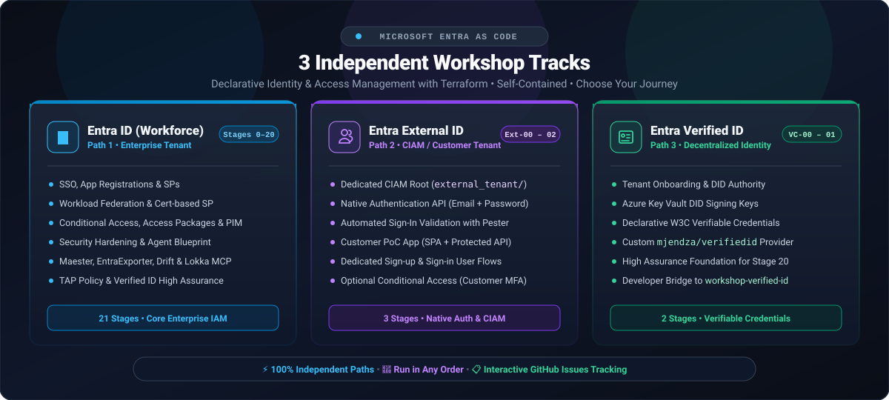
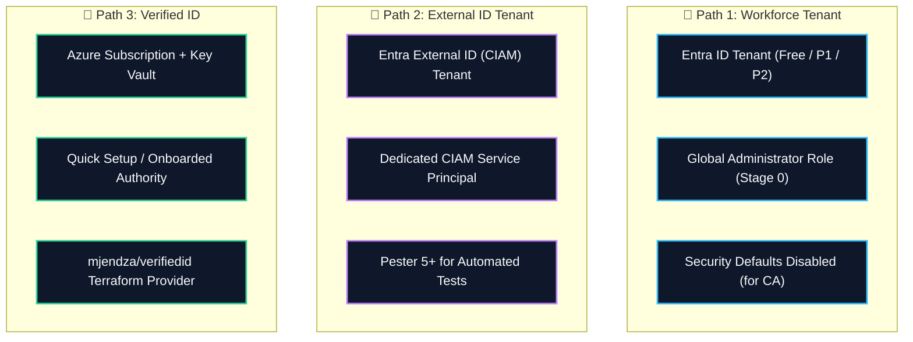

# Microsoft Entra as Code Workshop 🚀

[](https://github.com/new?template_owner=mjendza&template_name=workshop-entra-as-code-interactive&owner=%40me&name=workshop-entra-as-code&description=Workshop:+Entra+ID+as+Code&visibility=public)
[](https://mjendza.github.io/workshop-entra-as-code-interactive/)
[](https://www.terraform.io/)
[](https://learn.microsoft.com/entra/)
[](https://github.com/mjendza/workshop-entra-as-code-interactive)
[](LICENSE.md)

---

<p align="center">
  
</p>

---

## Welcome to Entra as Code!

Welcome to the **Microsoft Entra as Code Workshop** — your hands-on, end-to-end journey into managing Microsoft cloud identity declaratively using **Terraform**, **Microsoft Graph**, and modern Infrastructure as Code (IaC) engineering practices.

Whether you are securing enterprise employee identities, building modern customer authentication flows into mobile and web apps, or issuing decentralized Verifiable Credentials, this repository is designed as **three completely independent, self-contained workshop tracks**:

1. 🏢 **[Path 1: Microsoft Entra ID (Workforce Tenant)](#path-1-workforce-tenant-stages-0--21)** — 22 stages covering enterprise single sign-on, workload identity federation, conditional access, privileged identity management (PIM), tenant hardening, security baseline testing (Maester, ZTA, Lokka MCP), certificate-based auth, secret monitoring, Temporary Access Pass (TAP), high-assurance Verified ID step-up, and just-in-time app roles (App Role PIM).
2. 👥 **[Path 2: Microsoft Entra External ID (Customer / CIAM Tenant)](#path-2-external-id-ciam-tenant)** — 3 stages focusing on customer-facing identity in a dedicated CIAM tenant: Native Authentication API (email + password), automated Pester test verification, and single sign-on for a Single Page Application (SPA) + backend API with dedicated user flows.
3. 🪪 **[Path 3: Microsoft Entra Verified ID (Decentralized Identity)](#path-3-verified-id)** — 2 stages covering tenant-level DID authority onboarding, Azure Key Vault signing keys, and declarative issuance of W3C Verifiable Credential contracts via the custom `mjendza/verifiedid` Terraform provider.

> [!TIP]
> **100% Independent Paths:** You do **not** need to complete Path 1 before tackling Path 2 or Path 3. Each path uses its own isolated Terraform root or stage sequence, dedicated service principals, and label sets. Pick the track that fits your current project or complete all three!

---

## 🎯 Which Path Should You Choose?

| Track | Target Tenant | Stages | What You Will Learn | Who It Is For |
|---|---|---|---|---|
| 🏢 **Path 1: Workforce** | Microsoft Entra ID (Enterprise) | **00 – 21** + Cleanup | App registrations, Service Principals, Workload Identity Federation, Conditional Access, PIM, Tenant Hardening, Maester, EntraExporter, Drift detection, Lokka MCP, Cert Auth, TAP policy, High Assurance step-up, App Role PIM | Cloud Engineers, Identity Architects, SecOps, DevOps |
| 👥 **Path 2: External ID** | Entra External ID (CIAM) | **Ext-00 – 02** | Dedicated `external_tenant/` root, Native Authentication API (headless email/password), Pester test automation, Customer SPA + API SSO, dedicated sign-up/sign-in user flows | App Developers, CIAM Engineers, Product Teams |
| 🪪 **Path 3: Verified ID** | Entra ID + Azure Subscription | **VC-00 – 01** | Tenant DID authority onboarding, Azure Key Vault DID signing keys, W3C Verifiable Credential contracts via `mjendza/verifiedid` provider | Trust Architects, Decentralized Identity & Security Engineers |

---

## 📋 Interactive Workshop Mode (Powered by GitHub Issues)

The most effective way to experience this workshop is via **Interactive Mode**. When you spawn your own copy of this repository using GitHub's template engine, an automated GitHub Actions pipeline instantly generates a dedicated **GitHub Issue for every single stage**.


### Why Interactive Mode?
- 📝 **Dedicated Checklists:** Track every task in the stage directly with checkboxes.
- 🏷️ **Clean Labeling:** Separate label categories for each path (`Workforce`, `External`, `VerifiedId`).
- 💬 **Personal Lab Notes:** Use issue comments to paste Terraform outputs, token claims, or troubleshooting notes.
- 🔄 **Preserved Links:** Stage documentation links automatically map to your own repository's issues!

### Getting Started in 3 Steps

1. Click the green badge below to create your repository:
   <br>[](https://github.com/new?template_owner=mjendza&template_name=workshop-entra-as-code-interactive&owner=%40me&name=workshop-entra-as-code&description=Workshop:+Entra+ID+as+Code&visibility=public)
2. Wait ~30 seconds for the initial GitHub Actions workflow to run (`Create Workshop Issues`).
3. Head over to the **Issues** tab in your new repository, pick your path, and begin with Stage 0!

---

## ⚠️ Important Risks, Warnings & Safety Guidelines

Before executing Terraform commands against your tenant, please review these key boundaries:

> [!WARNING]
> **Stage 7 (Tenant Security Hardening):** Modifies singleton authorization policies at the tenant level (restricting guest user invitations, self-service app registrations, and group creation). While safe defaults are provided, **we strongly recommend running this in a dedicated sandbox or development tenant**.

> [!NOTE]
> **Stage 8 (Agent Identity Blueprint) & Stage 20 (High Assurance):** These stages leverage Microsoft Graph **beta endpoints** and preview features. If schema changes occur upstream in Microsoft Graph, refer to the respective stage documentation for updates.

> [!CAUTION]
> **Stage 21 (App Role PIM):** PIM for app roles is in **private preview**. Your tenant must be enrolled by Microsoft, and the eligible assignment and role settings are configured manually in the portal (no public Graph API yet).

> [!WARNING]
> **Stage 19 (Temporary Access Pass):** Manages the tenant-wide Authentication Methods policy singleton. You can scope the policy to a specific pilot group via `include_target_group_id` rather than all users.

> [!IMPORTANT]
> **Stage Cleanup:** Upon running `terraform destroy`, tenant-level singleton policies (such as the authorization policy in Stage 7 or TAP in Stage 19) are reverted back to their baseline default configuration, as tenant singletons cannot be physically deleted. Remember to revoke any active Access Package assignments prior to destroying Stage 5!

---

## 🗺️ Detailed Roadmaps

### Path 1: Workforce Tenant (Stages 0 – 21)

Path 1 uses the dedicated [`workforce/`](workforce/) Terraform root (`workforce/main.tf`, `workforce/variables.tf`, `workforce/provider.tf`, `workforce/modules/`) and manages core enterprise identity, access governance, and security posture in a standard Microsoft Entra ID tenant.

#### Phase 1: Foundations & Identities (Stages 00 – 03)
| Stage | Title | Description | Requirements |
|:---:|---|---|---|
| [00](doc/stage-00) | **Prerequisites** | Create the bootstrapping Service Principal and secret in Azure Portal with minimal required permissions. Retrieve tenant credentials. | Global Admin |
| [01](doc/stage-01) | **SSO Application** | Automate the deployment of an App Registration configured for Single Sign-On with OIDC Debugger. Inspect token claims. | - |
| [02](doc/stage-02) | **Service Principal** | Provision a backend Service Principal with programmatic credential management in Terraform. | - |
| [03](doc/stage-03) | **Workload Identity Federation** | Configure passwordless Service Principal authentication using OIDC Federated Identity Credentials for external systems. | - |

#### Phase 2: Access Governance & Zero Trust (Stages 04 – 06)
| Stage | Title | Description | Requirements |
|:---:|---|---|---|
| [04](doc/stage-04) | **Conditional Access** | Automate Conditional Access policy deployment scoped to the SSO application with network and location boundary controls. | Entra ID P1, Security Defaults disabled |
| [05](doc/stage-05) | **Access Package** | Provision Entra ID Entitlement Management Access Packages for structured, auditable self-service onboarding. | Entra ID P2 |
| [06](doc/stage-06) | **Privileged Identity Management (PIM)** | Enforce just-in-time, eligible role assignments instead of permanent standing administrative privileges. | Entra ID P2 |

#### Phase 3: Tenant Hardening & Modern Identities (Stages 07 – 08)
| Stage | Title | Description | Requirements |
|:---:|---|---|---|
| [07](doc/stage-07) | **Tenant Security Hardening** | Restrict guest invitations, standard user app creation, and security group creation using the `microsoft/msgraph` provider. | Sandbox / Dev Tenant |
| [08](doc/stage-08) | **Entra Agent Identity (Preview)** | Deploy an Agent Identity Blueprint, Blueprint Principal, and Agent Identity using Microsoft Graph beta endpoints. | Dev Tenant |

#### Phase 4: Security Posture, Baselines & AI Operations (Stages 09 – 13)
| Stage | Title | Description | Requirements |
|:---:|---|---|---|
| [09](doc/stage-09) | **Maester Security Tests** | Provision a dedicated Service Principal and execute automated Maester PowerShell test suites against Microsoft security baselines. | - |
| [10](doc/stage-10) | **EntraExporter** | Export your entire tenant's configuration to version-controlled JSON snapshots for auditing and disaster recovery. | - |
| [11](doc/stage-11) | **Zero Trust Assessment** | Automate provisioning for Zero Trust Assessment (ZTA) tool to audit maturity across identity pillars. | - |
| [12](doc/stage-12) | **Configuration Drift (Diff)** | Combine Maester and EntraExporter into a continuous drift-detection workflow to catch out-of-band portal changes. | - |
| [13](doc/stage-13) | **Lokka MCP** | Provision an MCP-enabled Service Principal to explore, query, and manage Entra ID using natural language in VS Code & NanoBot. | - |

#### Phase 5: Application Security & Automation (Stages 14 – 17)
| Stage | Title | Description | Requirements |
|:---:|---|---|---|
| [14](doc/stage-14) | **SPA SSO** | Configure a Single Page Application (SPA) with PKCE redirect URIs, custom API scopes, and identifier URIs. | - |
| [15](doc/stage-15) | **Application Roles (App Roles)** | Define custom application roles for role-based access control (RBAC) and verify token role claims. | - |
| [16](doc/stage-16) | **Certificate-Based Authentication** | Transition Service Principals from shared secrets to X.509 certificate authentication for elevated security. | OpenSSL / Cert |
| [17](doc/stage-17) | **CI/CD Automation Pipelines** | Automate Terraform plans, applies, and Maester compliance tests inside GitHub Actions pipelines. | GitHub Repo |

#### Phase 6: Advanced Operations & High Assurance (Stages 18 – 21)
| Stage | Title | Description | Requirements |
|:---:|---|---|---|
| [18](doc/stage-18) | **Multitenant Secret Monitoring** | Centralize credential and secret expiration tracking across multiple Entra ID tenants using workload federation. | GitHub Repo |
| [19](doc/stage-19) | **Temporary Access Pass (TAP)** | Manage the tenant-wide Authentication Methods policy to issue expiring passcodes for passwordless bootstrapping. | Sandbox / Dev Tenant |
| [20](doc/stage-20) | **High Assurance - Verified ID with CA (Preview)** | Require users to present a Verified ID (W3C Verifiable Credential) via Conditional Access to access sensitive applications. | Entra ID P1, Verified ID (VC-00) |
| [21](doc/stage-21) | **Entra ID App Role PIM (Preview)** | Replace standing app role assignments with PIM eligible assignments: users activate a privileged app role just-in-time (MFA, justification, approval) and the `roles` claim appears only while active. | Private preview enrollment, E7 / ID Governance |

#### Phase 7: Disassembly & Bonus
| Stage | Title | Description | Requirements |
|:---:|---|---|---|
| [Cleanup](doc/stage-cleanup) | **Architecture Disassembly** | Execute structured `terraform destroy` to tear down workshop resources and restore baseline tenant policies. | - |
| [Next Steps](doc/stage-next) | **Bonus: Enterprise Scale** | Guidelines for remote state backends (Azure Blob), Spacelift.io orchestration, and production pipeline patterns. | - |

---

### Path 2: External ID (CIAM) Tenant

Path 2 is completely isolated inside the [`external_tenant/`](external_tenant) directory with its own Terraform provider configurations and dedicated Service Principal. It focuses on customer-facing identities and CIAM developer experiences.

| Step                           | Title                              | Description                                                                                                                                                                                                                           |
|--------------------------------|------------------------------------|---------------------------------------------------------------------------------------------------------------------------------------------------------------------------------------------------------------------------------------|
| [external-00](doc/external-00) | Prerequisites (External ID tenant) | Create a second Service Principal, this time in your External ID (CIAM) tenant, with every Microsoft Graph permission the `external_tenant/` Terraform root needs (native auth, user flows, conditional access, groups, local users). |
| [external-01](doc/external-01) | Native Authentication              | Enable Entra External ID's Native Authentication API (email + password) on a native app registration, and prove the sign-in flows end-to-end with Pester via registered user also in terraform .                                      |
| [external-02](doc/external-02) | SSO for your CustomerHelpdesk App               | Browser-based SSO for a CustomerHelpdesk SPA + API with a dedicated email + password user flow assigned to the app; optional Conditional Access (MFA) - requires Security defaults to be disabled.                                                 |
| [external-03](doc/external-03) | Passwordless SSO + MFA (SMS)      | Same CustomerHelpdesk SPA + API pattern with a passwordless Email OTP user flow, SMS enabled as a tenant authentication method, and a required Conditional Access MFA policy (SMS as second factor). |
| [external-04](doc/external-04) | Sign-up with extra attributes     | Collect first and last name plus two required custom boolean checkboxes (terms of use, privacy policy) during sign-up, using tenant-level custom user attributes created by Terraform. |
| [external-05](doc/external-05) | Profile sync + token enrichment   | Custom authentication extensions: push the sign-up data (name + consents) to your own profile API on submit, and enrich ID/access tokens with profile claims on token issuance. Starts with a Stub Profile Implementation. |

---

### Path 3: Verified ID

Path 3 focuses on decentralized identity, Verifiable Credentials (VCs), and the decentralized identifier (DID) trust model. It operates in [`verified_id/`](verified_id) and integrates with the custom `mjendza/verifiedid` provider.

| Stage | Title | Description | Key Artifacts |
|:---:|---|---|---|
| [vc-00](doc/vc-00) | **Tenant Onboarding to Verified ID** | Complete tenant-level onboarding for Microsoft Entra Verified ID using Quick Setup and link your Azure Key Vault for DID signing keys. | Azure Key Vault, DID Authority |
| [vc-01](doc/vc-01) | **Register VC Contract** | Extend the certificate-bound Service Principal to the Verified ID Admin API and author a declarative W3C Verifiable Credential contract via Terraform. | `mjendza/verifiedid` provider, Contract Rules & Display |

> 🚀 **Next Steps After Path 3:** To issue, present, and verify your credential from a live running application, check out the companion [workshop-verified-id](https://github.com/mjendza/workshop-verified-id) developer repository!

---

## 🛠️ Prerequisites & Tenant Requirements

### Technical Tooling (All Paths)
- ✅ **Workstation:** Windows, macOS, or Linux.
- ✅ [Visual Studio Code](https://code.visualstudio.com/) (recommended editor).
- ✅ [Terraform](https://www.terraform.io/) **v1.0 or newer**.
- ✅ [Git](https://git-scm.com/) installed and configured.
- ✅ [PowerShell 7+](https://github.com/PowerShell/PowerShell) (used for Maester and Pester verification scripts).

### Tenant Requirements by Path



- **Path 1 (Workforce):**
  - An [Entra ID Tenant](https://www.microsoft.com/security/business/identity-access/microsoft-entra-id) with **Global Administrator** access for initial setup.
  - An **Entra ID P1 or P2 license** (Required for Stages 4–6: Conditional Access, Access Packages, and PIM). Free tier works for Stages 0–3 and 7–19!
  - **Security Defaults MUST be disabled** if testing Conditional Access (Stage 4 & Stage 20).
- **Path 2 (External ID):**
  - An [Entra External ID tenant](https://learn.microsoft.com/entra/external-id/customers/how-to-create-external-tenant-portal) (free trial or pay-as-you-go).
- **Path 3 (Verified ID):**
  - An active **Azure Subscription** with permissions to deploy an **Azure Key Vault** (to store DID signing keys).

---

## ⚡ Environment Setup & Quick Reference

### Install CLI Tools

#### Windows (via winget)
```powershell
winget install Microsoft.VisualStudioCode
winget install HashiCorp.Terraform
winget install Git.Git
winget install Microsoft.PowerShell
```

#### macOS (via Homebrew)
```bash
brew install --cask visual-studio-code
brew install hashicorp/tap/terraform
brew install git
brew install --cask powershell
```

### Recommended VS Code Extensions
- [HashiCorp Terraform](https://marketplace.visualstudio.com/items?itemName=HashiCorp.terraform) — Syntax highlighting, auto-formatting, and autocomplete.
- [REST Client](https://marketplace.visualstudio.com/items?itemName=humao.rest-client) — For testing `.http` token queries.
- [PowerShell](https://marketplace.visualstudio.com/items?itemName=ms-vscode.PowerShell) — For executing Maester and Pester validation scripts.

### Terraform Quick Reference

Run the commands inside the Terraform root of your path: `workforce/` (Path 1), `external_tenant/` (Path 2) or `verified_id/` (Path 3).

```shell
cd workforce

# Initialize provider plugins and working directories
terraform init

# Review execution plan before making changes
terraform plan

# Apply infrastructure changes
terraform apply

# Clean up provisioned resources
terraform destroy
```

---

## ❓ Frequently Asked Questions (FAQ)

| Question | Answer |
|---|---|
| **Do I need an Azure Subscription?** | **No** for Path 1 (Workforce) and Path 2 (External ID) — both focus exclusively on Microsoft Entra ID. **Yes** for Path 3 (Verified ID), which requires an Azure Key Vault to store DID cryptographic signing keys. |
| **Can I use my organization's production tenant?** | **No, strongly discouraged.** We recommend creating a free [Microsoft 365 Developer Program](https://developer.microsoft.com/microsoft-365/dev-program) tenant or an Azure free trial tenant. Stages 7, 19, and 20 modify tenant-wide policies. |
| **Do I need to do the paths in order?** | **No.** Path 1, Path 2, and Path 3 are 100% independent. You can do just External ID, just Verified ID, or just Workforce. |
| **Is this workshop meant to teach Terraform from scratch?** | While basic Terraform usage is covered, the workshop focuses on **applying Infrastructure as Code to Entra ID architecture and identity security**, rather than general HCL syntax. |
| **Can I run this on Linux or macOS?** | **Yes.** All Terraform modules and Microsoft Graph requests are platform-agnostic. PowerShell scripts (Maester/Pester) run seamlessly on PowerShell 7+ on Linux and macOS. |
| **What happens to tenant-wide policies during `terraform destroy`?** | Singletons like authorization policies (Stage 7) and TAP (Stage 19) cannot be destroyed by Entra ID; Terraform safely restores them to their default permissive baseline configurations. |

---

## 📜 Changelog

| Version | Date | Description |
|:---:|:---:|---|
| **v2.2** | 2026.11.22 | 🧪 Added **Stage 21** (Entra ID App Role PIM - just-in-time app roles, private preview). |
| **v2.1** | 2026.11.20 | 🌟 Added **Stage 20** (High Assurance: Require Verified ID with Conditional Access). |
| **v2.0** | 2026.07.06 | 🎆 **Major Reorganization:** Restructured workshop into 3 independent paths (Workforce, External ID, Verified ID). |
| **v1.11** | 2026.07.04 | Added **Stage Extra External ID** (Native Authentication & Pester testing). |
| **v1.10** | 2026.06.23 | Added **Stage 19** (Temporary Access Pass Policy via `msgraph` PATCH). |
| **v1.9** | 2026.05.17 | Added **Stage 18** (Multitenant Secret Monitoring) and 101 Verified ID track. |
| **v1.8** | 2026.05.06 | Added **Stage 17** (CI/CD Pipelines for Maester and ZTA). |
| **v1.7** | 2026.04.30 | Added **Stages 14–16** (SPA SSO, Application Roles, Certificate-based Service Principals). |
| **v1.6** | 2026.03.13 | Added **Stage 12** (Configuration Drift with Maester + EntraExporter) and **Stage 13** (Lokka MCP). |
| **v1.5** | 2026.03.04 | Added **Stage 11** (Zero Trust Assessment - ZTA). |
| **v1.4** | 2026.03.03 | Added **Stage 10** (EntraExporter tenant snapshots). |
| **v1.3** | 2026.03.02 | Added **Stage 9** (Maester automated security baseline tests). |
| **v1.2** | 2026.02.24 | Added **Stage 8** (Entra ID Agent Identity Blueprint via Graph beta). |
| **v1.1** | 2026.02.19 | Added **Stage 7** (Tenant Security Hardening via `microsoft/msgraph`). |
| **v1.0** | 2026.01.05 | 🎆 Initial public interactive release. |

---

## 💬 Community, Feedback & Support

- 🐛 **Found a bug or have a suggestion?** Please [open an issue](https://github.com/mjendza/workshop-entra-as-code-interactive/issues) in this repository.
- ⭐ **Enjoying the workshop?** Star the repository to show support and help other identity engineers discover it!
- 🤝 **Contributions:** Pull requests improving documentation, test suites, or new Entra features are warmly welcomed.
