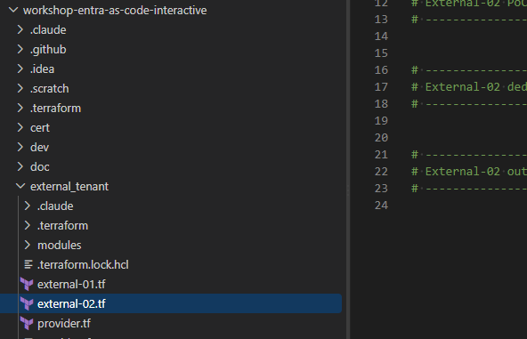

# External-02: SSO for your PoC App (SPA + API) with a dedicated user flow

External-01 used the Native Authentication API (custom developed; custom branded; maybe simpler;). This stage does the classic thing: a
browser-based single sign-on for a proof-of-concept (your first DEMO) web app. Customers are redirected to your
External ID tenant's authorization page (`<subdomain>.ciamlogin.com`), sign up or sign in with
`email + password`, and the SPA gets an ID token plus an access token for its own API.

The stage has two equally important halves:

1. The PoC application - an API and a SPA, with admin consent **granted manually in the Azure Portal**
   so no customer sees a consent prompt.
2. A dedicated user flow (email + password) assigned to the PoC application. In External ID,
   the user flow is what defines the sign-in experience: which identity providers are offered,
   whether sign-up is allowed, and which attributes are collected. An app registration without a
   user flow has no customer sign-up experience at all.


## What will be created

| Object                    | Display name                         | Notes                                                                                                                             |
|---------------------------|--------------------------------------|-----------------------------------------------------------------------------------------------------------------------------------|
| API (resource server)     | `TF.Demo.<name>-PoC.API.API`         | `api://<client-id>`, scope `access_as_user` (Admin consent), app role `PoC.Admin`. No redirect URI, no secret.                    |
| SPA                       | `TF.Demo.<name>-PoC.Spa.Application` | SPA platform only (auth code + PKCE, public client). Requests `openid profile email offline_access User.Read` + `access_as_user`. |
| Admin consent             | -                                    | **Manual** (Azure Portal, step 5) - tenant-wide grant for all of the SPA's delegated permissions. Not done by Terraform.          |
| Sign-up/sign-in user flow | `TF.Workshop.<name>-PoC.Flow`        | Email + password only. Dedicated to the PoC app - the SPA is assigned to it.                                                      |
| Conditional Access        | `TF.Demo.<name>-PoC.RequireMFA`      | Only when `poc_require_mfa = true`. Requires MFA (Email OTP) on the SPA and the API. Needs Security defaults disabled.            |

`<name>` is your `deployment_unique_name`.

## How to work with Terraform Workshop

Each Entra External ID workshop step should updated dedicated Terraform file - name is always same as step number.

## Part 1: the PoC application

From [`external_tenant/modules/poc_app`](../../external_tenant/modules/poc_app/main.tf) - API, SPA
and the optional Conditional Access policy. Admin consent is NOT part of the Terraform code - you
grant it manually in the Azure Portal after `apply` (step 5):

```hcl
module "poc_app" {
  source            = "./modules/poc_app"
  name              = "${var.deployment_unique_name}-PoC"
  spa_redirect_uris = var.poc_spa_redirect_uris

  # OPTIONAL - Conditional Access (MFA via Email OTP). Off by default.
  # Security defaults must be disabled in the tenant before setting this to true.
  require_mfa = var.poc_require_mfa
}

# "User assignment required?" on the API enterprise application would make Entra
# refuse tokens to every role-less customer, one layer above the API.
check "poc_api_open_to_role_less_users" {
  assert {
    condition     = module.poc_app.api_user_assignment_required == false
    error_message = "The PoC API enterprise application requires user assignment. Role-less customers cannot obtain a token at all."
  }
}
```

## Part 2: the dedicated user flow (email + password) assigned to the PoC app

```hcl
module "poc_user_flow" {
  source              = "./modules/user_flow"
  deployment_env_name = var.deployment_env_name
  business_name       = "${var.deployment_unique_name}-PoC"
  sign_up_allowed     = var.poc_sign_up_allowed

  app_client_ids = {
    poc_spa = module.poc_app.spa_client_id
  }

  depends_on = [module.poc_app]
}
```

### What is inside the flow

[`external_tenant/modules/user_flow`](../../external_tenant/modules/user_flow/main.tf) creates an
`externalUsersSelfServiceSignUpEventsFlow` (Graph `identity/authenticationEventsFlows`, beta) with:

| Setting              | Value                                                         | Effect on the hosted sign-in page                                                                                                                                |
|----------------------|---------------------------------------------------------------|------------------------------------------------------------------------------------------------------------------------------------------------------------------|
| Identity provider    | `EmailPassword-OAUTH` (Email with password)               | Customers sign in with their e-mail address and a password. No social IdPs, no passwordless email OTP as the *primary* method.                                   |
| `isSignUpAllowed`    | `var.poc_sign_up_allowed` (default `true`)                    | `true` shows "No account? Create one": self-service sign-up with an e-mail verification code, then a password. `false` = sign-in only for existing accounts. |
| Collected attributes | `email` (hidden, from verification), `displayName` (optional) | Fields shown on the sign-up page and written to the user object.                                                                                                 |
| User type created    | `member`                                                      | Signed-up customers become member users of the External ID tenant.                                                                                               |

### How the PoC app is assigned to it

- `app_client_ids` takes a map of static label → client ID. For each entry, the module calls
  `POST identity/authenticationEventsFlows/{id}/conditions/applications/includeApplications` with
  the app's `appId` (`msgraph_resource_action`).
- Only the SPA is assigned. Customers sign in *to the SPA*; the API is never signed in to
  directly - it only receives the access token issued during the SPA's sign-in, so it doesn't need a flow.
- `depends_on = [module.poc_app]` - `includeApplications` rejects an app that has no service
  principal yet, so the assignment must wait for the SPA's enterprise application.
- An application can be assigned to only ONE user flow. That's why the PoC app gets its own
  flow instead of reusing External-01's `password_user_flow`, and it's what lets the PoC app have its
  own sign-up policy (`poc_sign_up_allowed`) without touching any other app.
- The POST runs once, on create. Later applies don't re-send it (it re-runs only if the flow ID or
  the client ID changes). Destroying it removes it from state but does not unassign the app -
  see Troubleshooting.

Requires `EventListener.ReadWrite.All` on the deployer Service Principal (External-00).

## Part 3: outputs for the PoC app

```hcl
output "external_poc_authority" {
  description = "MSAL authority for the External ID tenant (https://<subdomain>.ciamlogin.com/)."
  value       = "https://${split(".", var.tenant_default_domain)[0]}.ciamlogin.com/"
}

output "external_poc_spa_client_id" {
  description = "Client ID of the PoC SPA (MSAL clientId)."
  value       = module.poc_app.spa_client_id
}

output "external_poc_api_client_id" {
  description = "Client ID of the PoC API (expected aud claim of its access tokens)."
  value       = module.poc_app.api_client_id
}

output "external_poc_api_scope" {
  description = "Scope the SPA requests to call the API."
  value       = module.poc_app.api_scope_uri
}

output "external_poc_user_flow_id" {
  description = "ID of the PoC app's dedicated email + password user flow."
  value       = module.poc_user_flow.user_flow_id
}

output "external_poc_ca_policy_id" {
  description = "Object ID of the optional require-MFA Conditional Access policy, or null when poc_require_mfa = false."
  value       = module.poc_app.ca_policy_id
}
```

The full solution is in [`doc/result/external_id/external-02.tf`](../result/external_id/external-02.tf).

## Workshop steps

### 1. Prerequisites

- [External-00](../external-00/README.md) completed - including `EventListener.ReadWrite.All`
  (assigning the SPA to its user flow). If you did External-00 before it was listed, add it now
  and press Grant admin consent again.
- An account with the **Cloud Application Administrator** (or Global Administrator) role in the
  External ID tenant - you need it to grant admin consent for the PoC SPA manually in step 5.
- A PoC SPA you can run locally (any MSAL-based app - e.g. `@azure/msal-browser` / `@azure/msal-react`),
  served on `http://localhost:5173/` by default.

### 2. (Optional) Conditional Access - disable Security defaults first

> [!IMPORTANT]
> **Security defaults must be DISABLED** in the External ID tenant before you turn on the optional
> Conditional Access policy. While security defaults are on, Microsoft Graph refuses to create any
> Conditional Access policy and `terraform apply` fails.
>
> Portal: Entra admin center (switched to the External ID tenant) → Identity → Overview →
> Properties → Manage security defaults → Disabled → Save.
>
> Disabling security defaults removes the tenant-wide baseline protection. Do it only in a
> workshop/PoC tenant, or replace it with your own Conditional Access policies.

Only if you want MFA on the PoC app:

1. Disable Security defaults (above).
2. Authentication methods → Email OTP: enabled for all users. If it is disabled, the policy
   blocks sign-ins outright instead of prompting for a code.
3. Leave SMS off if Email OTP must be the only second factor (SMS is a paid add-on).

The policy targets *All users* but only the PoC SPA and API, so it can't lock you out of the portal.
MFA works here because the user flow's primary method is email + password - an email-OTP primary
sign-in cannot also count as the second factor.

Skip this step entirely to keep `poc_require_mfa = false` (the default).

### 3. Configure `external_tenant/terraform.tfvars`

All three variables have defaults - add them only to change something:

```hcl
poc_spa_redirect_uris = ["http://localhost:5173/"]   # must match your SPA EXACTLY (trailing slash!)
poc_sign_up_allowed   = true                         # user flow: false = sign-in only, nobody can self-register
poc_require_mfa       = false                        # OPTIONAL CA policy - see step 2 first
```

### 4. Add the code and apply

Paste Part 1, Part 2 and Part 3 into the matching sections of
[`external_tenant/external-02.tf`](../../external_tenant/external-02.tf), then:

```powershell
cd external_tenant
terraform init      # new modules
terraform plan      # expect module.poc_user_flow.msgraph_resource_action.app_assignment["poc_spa"]
terraform apply
```

### 5. Grant admin consent for the PoC SPA (manual, Azure Portal)

> [!IMPORTANT]
> Terraform deliberately does **not** grant admin consent. Do it by hand in the portal - without
> this step every sign-in fails with `AADSTS65001` (consent required), because `access_as_user`
> has consent type *Admin* and customers cannot consent to it themselves.

1. Entra admin center (switched to the External ID tenant) → **Identity** → **Applications** →
   **App registrations** → **All applications** → `TF.Demo.<name>-PoC.Spa.Application`.
2. **API permissions** → **Grant admin consent for `<tenant>`** → **Yes**.
3. Every row - `openid`, `profile`, `email`, `offline_access`, `User.Read` (Microsoft Graph) and
   `access_as_user` (`TF.Demo.<name>-PoC.API.API`) - must show *Granted for `<tenant>`*.

Repeat this whenever the SPA's API permissions change, or after a `destroy` + re-`apply` (a new
app registration has no consent).

### 6. Wire up your PoC app

```powershell
terraform output -raw external_poc_authority      # MSAL authority
terraform output -raw external_poc_spa_client_id  # MSAL clientId
terraform output -raw external_poc_api_scope      # scope to call your API
terraform output -raw external_poc_api_client_id  # aud your API must validate
```

Example MSAL configuration:

```js
const msalConfig = {
  auth: {
    clientId: "<external_poc_spa_client_id>",
    authority: "<external_poc_authority>",         // https://<subdomain>.ciamlogin.com/
    redirectUri: "http://localhost:5173/",
  },
};
const loginRequest = { scopes: ["openid", "profile", "offline_access", "<external_poc_api_scope>"] };
```

Note there is no user flow name in the authority (unlike Azure AD B2C's `/B2C_1_signupsignin`
policies). External ID picks the flow from the application: whichever flow the SPA's client ID is
assigned to is the one the hosted page renders.

### 7. Test the user flow

1. Run the app and click sign in - you land on the External ID hosted page showing Email +
   Password fields and a "No account? Create one" link.
2. Sign up: enter a new e-mail → enter the verification code sent to it → set a password →
   (optionally) a display name → you return to the PoC app signed in.
3. Sign in: sign out, then sign in again with the same e-mail and password - no code this time.
4. Set `poc_sign_up_allowed = false`, apply, reload the sign-in page: the "Create one" link is gone,
   while existing accounts can still sign in.
5. With `poc_require_mfa = true` you additionally get an Email OTP prompt after the password.

## Verification

- [ ] `TF.Demo.<name>-PoC.Spa.Application` and `TF.Demo.<name>-PoC.API.API` exist under App registrations.
- [ ] The SPA's API permissions all show *Granted for `<tenant>`* (manual consent, step 5).
- [ ] External Identities → User flows → `TF.Workshop.<name>-PoC.Flow`:
  - Identity providers shows only Email with password.
  - Applications lists only `TF.Demo.<name>-PoC.Spa.Application`.
- [ ] Sign-up (with e-mail code + password) and sign-in (password only) both work from the PoC app.
- [ ] (Optional) Conditional Access lists `TF.Demo.<name>-PoC.RequireMFA` and sign-in asks for an Email OTP.

Graph check of the assignment (Graph Explorer signed in to the External ID tenant):

```http
GET https://graph.microsoft.com/v1.0/identity/authenticationEventsFlows/<external_poc_user_flow_id>/conditions/applications/includeApplications
```

should return exactly one entry whose `appId` equals `external_poc_spa_client_id`.

## Troubleshooting

| Issue                                                                                            | Solution                                                                                                                                                                           |
|--------------------------------------------------------------------------------------------------|------------------------------------------------------------------------------------------------------------------------------------------------------------------------------------|
| 403 on `msgraph_resource_action.app_assignment`                                                  | Deployer SP is missing `EventListener.ReadWrite.All` (External-00).                                                                                                                |
| 400 on `app_assignment` - app is already linked to another flow                                  | An application can belong to only one user flow. Remove the SPA from the other flow (User flows → *other flow* → Applications) and apply again.                                    |
| 400 on `app_assignment` - application/service principal not found                                | The SPA's service principal didn't exist yet. Keep `depends_on = [module.poc_app]` on `poc_user_flow` and re-run `apply`.                                                          |
| Hosted page has no sign-up option and the e-mail + password sign-in doesn't behave as configured | The SPA isn't assigned to the PoC user flow. Check the flow's Applications blade.                                                                                              |
| Sign-in page doesn't show "No account? Create one"                                               | `poc_sign_up_allowed = false`, or the SPA isn't assigned to the flow.                                                                                                              |
| `apply` fails creating the CA policy (`Security Defaults is enabled in the tenant`, 400/403)     | Security defaults are still on - see step 2, or set `poc_require_mfa = false`.                                                                                                     |
| CA policy blocks sign-in instead of asking for a code                                            | Email OTP is not enabled in Authentication methods.                                                                                                                                |
| `AADSTS50011` redirect URI mismatch                                                              | `poc_spa_redirect_uris` must match the app's redirect URI exactly, including the trailing slash.                                                                                   |
| `AADSTS65001` consent required                                                                   | Admin consent wasn't granted. Do step 5: Portal → App registrations → PoC SPA → API permissions → Grant admin consent for `<tenant>`.                                              |
| `destroy` fails deleting the user flow                                                           | Destroying the assignment doesn't unassign the app (the POST only runs on create). Remove the app from the flow in the portal (User flows → Applications) and run `destroy` again. |

---

## Stage Completion Checklist
- [ ] I have added `EventListener.ReadWrite.All` to the External-00 Service Principal.
- [ ] I have applied External-02 and captured the outputs.
- [ ] I have manually granted admin consent for the PoC SPA in the Azure Portal (API permissions → Grant admin consent).
- [ ] The dedicated `TF.Workshop.<name>-PoC.Flow` user flow offers Email with password and has only the PoC SPA assigned.
- [ ] My PoC app signs customers up (e-mail code + password) and in (password) through the External ID hosted page.
- [ ] (Optional) I have disabled Security defaults, set `poc_require_mfa = true`, and seen the Email OTP prompt.

> **Report Issues:** Did you encounter a bug or need clarification? [Report the issue here](https://github.com/mjendza/workshop-entra-as-code-interactive/issues).

---
**Navigation:** [← External-01: Native Authentication](../external-01/README.MD)
