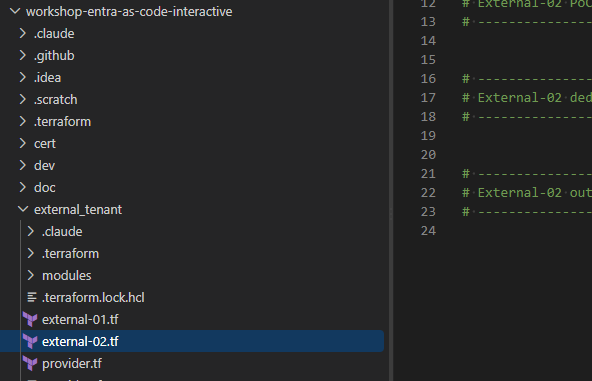

# External-03: Passwordless SSO for your CustomerHelpdesk App (Email OTP) with MFA (SMS)

External-02 signed customers in with `email + password`, and MFA was optional. This stage builds the
same CustomerHelpdesk app (SPA + API) again, with three differences:

1. **No password at all.** The dedicated user flow uses the built-in **Email one-time passcode**
   identity provider (`EmailOtpSignup-OAUTH`). Each sign-up and sign-in sends a code to the
   customer's mailbox.
2. **SMS is enabled in the tenant** as an authentication method. Terraform makes a tenant-wide
   PATCH to the authentication methods policy.
3. **MFA is required.** A Conditional Access policy on the SPA and the API demands a second
   factor, and that factor is an **SMS code**.

> [!NOTE]
> **Why SMS and not Email OTP as the second factor?** The primary sign-in already *is* an email
> one-time passcode, and the same method cannot count twice. After an Email OTP sign-in, SMS is the
> only MFA method External ID can offer a customer. If SMS is unavailable, the CA policy blocks
> sign-in outright instead of prompting.

## What will be created

| Object                    | Display name                             | Notes                                                                                                                              |
|---------------------------|------------------------------------------|------------------------------------------------------------------------------------------------------------------------------------|
| SMS authentication method | *(tenant-wide policy)*                   | `authenticationMethodConfigurations/Sms` → `enabled` for `all_users`, `isUsableForSignIn = false` (second factor only). Singleton PATCH. |
| API (resource server)     | `TF.Demo.<name>-CustomerHelpdesk-OTP.API.API`         | `api://<client-id>`, scope `access_as_user` (Admin consent), app role `CustomerHelpdesk.Admin`. No redirect URI, no secret.                     |
| SPA                       | `TF.Demo.<name>-CustomerHelpdesk-OTP.Spa.Application` | SPA platform only (auth code + PKCE, public client). Requests `openid profile email offline_access User.Read` + `access_as_user`.  |
| Admin consent             | -                                        | **Manual** (Azure Portal, step 6). Not done by Terraform.                                                                         |
| Sign-up/sign-in user flow | `TF.Workshop.<name>-CustomerHelpdesk-OTP.Flow`        | **Email one-time passcode** only, passwordless. Dedicated to the CustomerHelpdesk-OTP app.                                                     |
| Conditional Access        | `TF.Demo.<name>-CustomerHelpdesk-OTP.RequireMFA`      | On by default (`otp_require_mfa = true`). Requires MFA (SMS) on the SPA and the API. Needs Security defaults disabled.            |

`<name>` is your `deployment_unique_name`. External-03 lives next to External-02. It does not
replace it: both CustomerHelpdesk apps, flows and CA policies exist side by side.

## How to work with Terraform Workshop

Each Entra External ID workshop step updates its own Terraform file, named after the step:
[`external_tenant/external-03.tf`](../../external_tenant/external-03.tf).

## Part 1: enable SMS in the tenant

[`external_tenant/modules/auth_methods_sms`](../../external_tenant/modules/auth_methods_sms/main.tf) uses
the `msgraph_resource_action` PATCH pattern from Stage 19's Temporary Access Pass module:

```hcl
module "otp_sms" {
  source = "./modules/auth_methods_sms"
  state  = var.otp_sms_state
}
```

The PATCH it sends:

```http
PATCH https://graph.microsoft.com/v1.0/policies/authenticationMethodsPolicy/authenticationMethodConfigurations/Sms
{
  "@odata.type": "#microsoft.graph.smsAuthenticationMethodConfiguration",
  "state": "enabled",
  "includeTargets": [
    { "targetType": "group", "id": "all_users", "isUsableForSignIn": false }
  ]
}
```

- `isUsableForSignIn = false`: SMS is a **second factor only**, never a primary passwordless
  sign-in method.
- It's a **singleton**. `terraform destroy` removes it from state but does **not** switch SMS off.
  To turn SMS off, set `otp_sms_state = "disabled"` and apply.
- Email OTP in Authentication methods stays as it is. External-02's optional MFA still depends on
  it.

Requires `Policy.ReadWrite.AuthenticationMethod` on the deployer Service Principal
([External-00 permissions](../external-00/README.md#required-microsoft-graph-permissions)).

## Part 2: the CustomerHelpdesk-OTP application (with MFA)

This is a second instance of External-02's
[`poc_app`](../../external_tenant/modules/poc_app/main.tf) module. You need a **new** SPA: an
application can be assigned to only ONE user flow, and External-02's SPA already belongs to the
email + password flow.

```hcl
module "otp_app" {
  source            = "./modules/poc_app"
  name              = "${var.deployment_unique_name}-CustomerHelpdesk-OTP"
  spa_redirect_uris = var.poc_spa_redirect_uris

  # Conditional Access (MFA via SMS). On by default in this stage.
  # Security defaults must be disabled in the tenant first.
  require_mfa = var.otp_require_mfa

  # The CA policy only makes sense once SMS can be used as the second factor.
  depends_on = [module.otp_sms]
}

check "otp_api_open_to_role_less_users" {
  assert {
    condition     = module.otp_app.api_user_assignment_required == false
    error_message = "The CustomerHelpdesk-OTP API enterprise application requires user assignment. Role-less customers cannot obtain a token at all."
  }
}

check "otp_mfa_has_second_factor" {
  assert {
    condition     = !var.otp_require_mfa || var.otp_sms_state == "enabled"
    error_message = "otp_require_mfa = true but SMS is disabled: after an Email OTP sign-in there is no second factor left and the CA policy blocks every sign-in."
  }
}
```

The CA policy (from [`ca_require_mfa`](../../external_tenant/modules/ca_require_mfa/main.tf))
targets *All users*, but only for this SPA and this API. It can't lock you out of the portal or
out of External-02's app.

## Part 3: the dedicated Email OTP user flow

```hcl
module "otp_user_flow" {
  source              = "./modules/user_flow"
  deployment_env_name = var.deployment_env_name
  business_name       = "${var.deployment_unique_name}-CustomerHelpdesk-OTP"
  sign_up_allowed     = var.otp_sign_up_allowed
  primary_method      = "otp"

  app_client_ids = {
    otp_spa = module.otp_app.spa_client_id
  }

  depends_on = [module.otp_app]
}
```

### What changed in the `user_flow` module

[`modules/user_flow`](../../external_tenant/modules/user_flow/main.tf) has a new `primary_method`
variable. Its default is `"password"`, so External-01 and External-02 plan with no changes:

| `primary_method`     | Identity provider id   | Display name on the hosted page | `identityProviderType` |
|----------------------|------------------------|---------------------------------|------------------------|
| `password` (default) | `EmailPassword-OAUTH`  | Email with password             | `EmailPassword`        |
| `otp`                | `EmailOtpSignup-OAUTH` | Email one-time passcode         | `EmailOTP`             |

Everything else in the flow matches External-02:

| Setting              | Value                                                         | Effect on the hosted sign-in page                                                                                       |
|----------------------|---------------------------------------------------------------|-------------------------------------------------------------------------------------------------------------------------|
| Identity provider    | `EmailOtpSignup-OAUTH` (Email one-time passcode)              | Customers enter an e-mail address and type the code sent to it. No password field, no "Forgot password?" link.         |
| `isSignUpAllowed`    | `var.otp_sign_up_allowed` (default `true`)                    | `true` shows "No account? Create one". `false` = sign-in only for existing accounts.                                    |
| Collected attributes | `email` (hidden, from verification), `displayName` (optional) | Fields shown on the sign-up page and written to the user object.                                                        |
| User type created    | `member`                                                      | Signed-up customers become member users of the External ID tenant.                                                      |

The SPA is assigned to the flow the same way as in External-02: a one-off
`POST .../conditions/applications/includeApplications` on create (`EventListener.ReadWrite.All`).

## Part 4: outputs for the CustomerHelpdesk-OTP app

```hcl
output "external_otp_authority" {
  description = "MSAL authority for the External ID tenant (https://<subdomain>.ciamlogin.com/)."
  value       = "https://${split(".", var.tenant_default_domain)[0]}.ciamlogin.com/"
}

output "external_otp_spa_client_id" {
  description = "Client ID of the CustomerHelpdesk-OTP SPA (MSAL clientId)."
  value       = module.otp_app.spa_client_id
}

output "external_otp_api_client_id" {
  description = "Client ID of the CustomerHelpdesk-OTP API (expected aud claim of its access tokens)."
  value       = module.otp_app.api_client_id
}

output "external_otp_api_scope" {
  description = "Scope the CustomerHelpdesk-OTP SPA requests to call the API."
  value       = module.otp_app.api_scope_uri
}

output "external_otp_user_flow_id" {
  description = "ID of the CustomerHelpdesk-OTP app's dedicated Email OTP user flow."
  value       = module.otp_user_flow.user_flow_id
}

output "external_otp_ca_policy_id" {
  description = "Object ID of the require-MFA Conditional Access policy, or null when otp_require_mfa = false."
  value       = module.otp_app.ca_policy_id
}
```

The full solution is in [`doc/result/external_id/external-03.tf`](../result/external_id/external-03.tf).

## Workshop steps

### 1. Prerequisites

- [External-02](../external-02/README.md) completed. You reuse its modules and
  `poc_spa_redirect_uris`.
- **New permission:** add `Policy.ReadWrite.AuthenticationMethod` (Application) to the
  [External-00 Service Principal](../external-00/README.md#required-microsoft-graph-permissions)
  and press **Grant admin consent**. Without it, the SMS PATCH fails
  with 403.
- An account with **Cloud Application Administrator** (or Global Administrator) rights in the
  External ID tenant, for the manual admin consent in step 6.
- A mobile phone that can receive text messages, for the test user.

### 2. SMS is a paid add-on: check billing

> [!IMPORTANT]
> In Microsoft Entra External ID, **SMS-based MFA is a premium add-on, billed per message**. The
> External ID tenant must be **linked to an Azure subscription** (see Microsoft's External ID
> billing / add-ons documentation for the current steps). Terraform can enable the method either
> way, but without the add-on customers don't receive the SMS and MFA fails.
>
> Some country codes are blocked by default because of SMS fraud protection. Use a phone number
> from a supported region for the test.

### 3. Disable Security defaults (required in this stage)

> [!IMPORTANT]
> **Security defaults must be DISABLED** in the External ID tenant. While security defaults are on,
> Microsoft Graph refuses to create any Conditional Access policy and `terraform apply` fails.
>
> Portal: Entra admin center (switched to the External ID tenant) → Identity → Overview →
> Properties → Manage security defaults → Disabled → Save.
>
> Disabling security defaults removes the tenant-wide baseline protection. Do it only in a
> workshop/test tenant, or replace it with your own Conditional Access policies.

If you already did this for External-02's optional MFA, skip it.

### 4. Configure `external_tenant/terraform.tfvars`

All variables have defaults. Add them only to change something:

```hcl
otp_sign_up_allowed = true        # user flow: false = sign-in only, nobody can self-register
otp_require_mfa     = true        # CA policy requiring MFA (SMS) - see step 3 first
otp_sms_state       = "enabled"   # tenant-wide SMS method; must be enabled while otp_require_mfa = true
```

The OTP SPA reuses `poc_spa_redirect_uris` from External-02. That includes
`https://tenant.factorlabs.pl/oidcdebugger/debug`, which step 7 needs.

### 5. Add the code and apply

Paste Part 1 to Part 4 into the matching sections of
[`external_tenant/external-03.tf`](../../external_tenant/external-03.tf), then:

```powershell
cd external_tenant
terraform init      # new module: auth_methods_sms
terraform plan      # expect module.otp_sms, module.otp_app (incl. ca_require_mfa[0]) and module.otp_user_flow
terraform apply
```

### 6. Grant admin consent for the CustomerHelpdesk-OTP SPA (manual, Azure Portal)

> [!IMPORTANT]
> Terraform deliberately does **not** grant admin consent. Without this step, every sign-in fails
> with `AADSTS65001`.

1. Entra admin center → **Identity** → **Applications** → **App registrations** →
   **All applications** → `TF.Demo.<name>-CustomerHelpdesk-OTP.Spa.Application`.
2. **API permissions** → **Grant admin consent for `<tenant>`** → **Yes**.
3. Every row (`openid`, `profile`, `email`, `offline_access`, `User.Read`, `access_as_user`) must
   show *Granted for `<tenant>`*.

### 7. Test with the OIDC debugger

Use the workshop OIDC debugger: **https://tenant.factorlabs.pl/oidcdebugger**

> [!NOTE]
> The debugger's **Import from Terraform output** only recognises External-02's `external_poc_*`
> outputs. For External-03, fill in the fields by hand:

```powershell
terraform output -raw external_otp_authority      # -> Authorization endpoint (press "Complete")
terraform output -raw external_otp_spa_client_id  # -> Client ID
terraform output -raw external_otp_api_scope      # -> Scope (after "openid profile offline_access")
terraform output -raw external_otp_api_client_id  # -> Expected audience
```

Press **Authorize**. The hosted page now shows **only an e-mail field**, with no password field.
Every row in the **Checks** table on the callback page should be PASS. In particular, the
**access token** `aud` must equal `external_otp_api_client_id`, and `scp` must contain
`access_as_user`.

### 8. Wire up your CustomerHelpdesk app

The MSAL configuration is the same as in External-02, using the `external_otp_*` outputs:

```js
const msalConfig = {
  auth: {
    clientId: "<external_otp_spa_client_id>",
    authority: "<external_otp_authority>",         // https://<subdomain>.ciamlogin.com/
    redirectUri: "http://localhost:5173/",
  },
};
const loginRequest = { scopes: ["openid", "profile", "offline_access", "<external_otp_api_scope>"] };
```

The app code doesn't change between password and OTP. External ID picks the flow from the client
ID, and the flow decides what the hosted page shows.

### 9. Test the user flow

1. **Sign up:** enter a new e-mail → **Send code** → enter the code from the mailbox →
   (optionally) a display name → CA requires MFA: **register a phone number** → enter the SMS
   code → you return to the app signed in.
2. **Sign in:** sign out → enter the same e-mail → enter the new code from the mailbox → enter the
   SMS code sent to the registered phone. No password at any point.
3. **Disable sign-up:** set `otp_sign_up_allowed = false`, apply, and reload. The "Create one"
   link is gone.
4. **Report-only:** to see the difference MFA makes, temporarily set `mfa_policy_state =
   "enabledForReportingButNotEnforced"` on `module.otp_app` (a module input) and apply. Sign-in then
   stops after the email code. The CA sign-in logs still show what *would* have happened.

## Verification

- [ ] Authentication methods → Policies → **SMS** is *Enabled* for *All users*, with
  *Use for sign-in* off.
- [ ] `TF.Demo.<name>-CustomerHelpdesk-OTP.Spa.Application` and `TF.Demo.<name>-CustomerHelpdesk-OTP.API.API` exist, and
  consent is granted.
- [ ] External Identities → User flows → `TF.Workshop.<name>-CustomerHelpdesk-OTP.Flow`:
  - Identity providers shows only **Email one-time passcode**.
  - Applications lists only `TF.Demo.<name>-CustomerHelpdesk-OTP.Spa.Application`.
- [ ] Conditional Access lists `TF.Demo.<name>-CustomerHelpdesk-OTP.RequireMFA` (*On*), targeting the OTP SPA and API.
- [ ] Sign-in asks for an e-mail code and then an SMS code, and never for a password.
- [ ] External-02's app still signs in with email + password (unaffected).

Graph checks (Graph Explorer, signed in to the External ID tenant):

```http
GET https://graph.microsoft.com/v1.0/policies/authenticationMethodsPolicy/authenticationMethodConfigurations/Sms
GET https://graph.microsoft.com/v1.0/identity/authenticationEventsFlows/<external_otp_user_flow_id>/microsoft.graph.externalUsersSelfServiceSignUpEventsFlow/onAuthenticationMethodLoadStart/microsoft.graph.onAuthenticationMethodLoadStartExternalUsersSelfServiceSignUp/identityProviders
```

The first must return `"state": "enabled"`. The second must return a single provider with
`"id": "EmailOtpSignup-OAUTH"`.

## Troubleshooting

| Issue                                                                     | Solution                                                                                                                                                         |
|---------------------------------------------------------------------------|------------------------------------------------------------------------------------------------------------------------------------------------------------------|
| 403 on `module.otp_sms.msgraph_resource_action.sms`                       | Deployer SP is missing `Policy.ReadWrite.AuthenticationMethod` (step 1), or admin consent wasn't granted for it.                                                 |
| `apply` fails creating the CA policy (`Security Defaults is enabled`)     | Security defaults are still on. See step 3.                                                                                                                     |
| Sign-in is **blocked** after the email code instead of asking for SMS     | SMS is disabled (`otp_sms_state`), or the tenant has no linked subscription for the SMS add-on. Email OTP can't be the second factor after an Email OTP sign-in. |
| The SMS never arrives                                                     | Check the subscription link (step 2) and the phone's country code (SMS fraud protection may block some regions). Look for the failure reason in the sign-in logs. |
| The hosted page still shows a password field                              | The SPA is assigned to a password flow (e.g. you reused External-02's SPA). Check the OTP flow's Applications blade.                                            |
| 400 on `app_assignment` - app is already linked to another flow           | An application can belong to only one user flow. Remove it from the other flow and apply again.                                                                  |
| `AADSTS65001` consent required                                            | Do step 6: grant admin consent for the OTP SPA.                                                                                                                |
| `AADSTS50011` redirect URI mismatch                                       | `poc_spa_redirect_uris` must match exactly, including the trailing slash.                                                                                        |
| SMS stays enabled after `terraform destroy`                               | Expected: the PATCH is a singleton. Set `otp_sms_state = "disabled"` and apply *before* destroying, or switch it off in the portal.                            |
| `destroy` fails deleting the user flow                                    | Unassign the SPA from the flow in the portal (User flows → Applications) and run `destroy` again.                                                               |

---

## Stage Completion Checklist
- [ ] I have added `Policy.ReadWrite.AuthenticationMethod` to the External-00 Service Principal and granted consent.
- [ ] My External ID tenant is linked to a subscription for the SMS add-on.
- [ ] Security defaults are disabled in the External ID tenant.
- [ ] I have applied External-03: SMS enabled, CustomerHelpdesk-OTP app, Email OTP user flow and the RequireMFA CA policy.
- [ ] I have manually granted admin consent for the CustomerHelpdesk-OTP SPA.
- [ ] I signed up and in **without a password** (e-mail code) and completed MFA with an **SMS code**.

> **Report Issues:** Did you encounter a bug or need clarification? [Report the issue here](https://github.com/mjendza/workshop-entra-as-code-interactive/issues).

---
**Navigation:** [← External-02: SSO for your CustomerHelpdesk App](../external-02/README.md) | [External-04: Sign-up with extra attributes →](../external-04/README.md)
