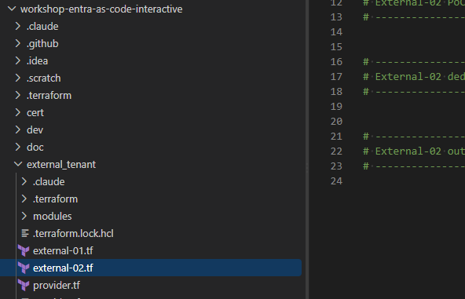

# External-04: Sign-up with extra attributes (first/last name, terms of use, privacy policy)

External-02 and External-03 collected just an e-mail and an optional display name at sign-up. Real
apps usually need more. This stage adds four fields to the sign-up page:

| Field                    | Attribute                                     | Type                   | Kind                                            |
|--------------------------|-----------------------------------------------|------------------------|-------------------------------------------------|
| First name               | `givenName`                                   | string (text box)      | Built-in, required                              |
| Last name                | `surname`                                     | string (text box)      | Built-in, required                              |
| Terms of use checkbox    | `extension_<appId>_TermsOfUseAccepted`        | boolean (checkbox)     | Custom, required (must be ticked)           |
| Privacy policy checkbox  | `extension_<appId>_PrivacyPolicyAccepted`     | boolean (checkbox)     | Custom, required (must be ticked)           |

The labels of both checkboxes contain Markdown links to your terms-of-use and privacy-policy pages.
Finally, both consent flags are added as claims to the SPA's ID token and the API's access token.

> [!NOTE]
> Built-in vs custom attributes. `givenName` and `surname` already exist on every user object,
> so the flow only has to ask for them. The two consent flags don't exist yet. You first create
> them as tenant-level custom user attributes. Entra stores their values on the
> *b2c-extensions-app* and names them `extension_<b2c-extensions-app appId without hyphens>_<name>`.

## What will be created

| Object                    | Display name                                | Notes                                                                                                     |
|---------------------------|---------------------------------------------|-----------------------------------------------------------------------------------------------------------|
| Custom user attribute     | `TermsOfUseAccepted`                        | Tenant-level, `boolean`. Created via the portal API (`b2cadmin`). Usable by any user flow in the tenant. |
| Custom user attribute     | `PrivacyPolicyAccepted`                     | Tenant-level, `boolean`.                                                                                  |
| API (resource server)     | `TF.Demo.<name>-CustomerHelpdesk-Extensions.API.API`         | Same as External-02: scope `access_as_user`, app role `CustomerHelpdesk.Admin`.                                        |
| SPA                       | `TF.Demo.<name>-CustomerHelpdesk-Extensions.Spa.Application` | Same as External-02: SPA platform, auth code + PKCE.                                                      |
| Admin consent             | -                                           | Manual (Azure Portal, step 5).                                                                        |
| Sign-up/sign-in user flow | `TF.Workshop.<name>-CustomerHelpdesk-Extensions.Flow`        | Email + password, plus first name, last name and the two required checkboxes. Only the SPA is assigned. |
| Claims mapping policy     | `TF.<name>.CustomerHelpdesk-Extensions.ConsentClaims`        | Step C. Adds `terms_of_use_accepted` and `privacy_policy_accepted` to the ID token (SPA) and the access token (API). |

`<name>` is your `deployment_unique_name`. External-02 and 03 stay untouched.

> [!IMPORTANT]
> This stage is applied in three steps. Step A (Part 1) creates only the custom attributes,
> and you check them in the portal. Step B (Parts 2 to 4) adds the app and the user flow that
> uses them. With a separate first apply, the user flow never waits for a just-created attribute
> to appear in Graph. Step C (Part 5) puts the stored values into the tokens, once you have
> seen them on the user object.

## How to work with Terraform Workshop

Each Entra External ID workshop step updates its own Terraform file, named after the step:
[`external_tenant/external-04.tf`](../../external_tenant/external-04.tf).

## Part 1 (Step A): the custom user attributes

[`external_tenant/modules/custom_user_attribute`](../../external_tenant/modules/custom_user_attribute/main.tf)
creates one attribute. It makes the same call the Entra admin center makes for External Identities → Custom
user attributes → Add:

```http
POST https://main.b2cadmin.ext.azure.com/api/userAttribute?tenantId=<external tenant id>&$orderby=DisplayName
Authorization: Bearer <user token, audience https://management.core.windows.net/>

{"dataType":2,"label":"TermsOfUseAccepted","adminHelpText":"...","userInputType":1,"userAttributeOptions":[],"attributeType":3}
```

`dataType` 1 = String, 2 = Boolean. `attributeType` 3 = custom.

This portal API is internal and undocumented, and it accepts only a delegated user token. The
deployer Service Principal can't call it. That's why the module runs
[`create.ps1`](../../external_tenant/modules/custom_user_attribute/create.ps1) through a `local-exec`
provisioner with your Azure CLI login. The script is idempotent: if `extension_<name>` already
exists with the same data type, it does nothing. After the create, the module reads the full id back
from Graph `identity/userFlowAttributes` with the deployer SP.

> [!NOTE]
> Alternative: the documented Graph API. You can also create the attribute with
> `POST https://graph.microsoft.com/v1.0/identity/userFlowAttributes` and
> `{"displayName":"TermsOfUseAccepted","dataType":"boolean"}`. That is pure Terraform: it uses only
> the deployer SP, needs no `az login`, and `destroy` deletes the attribute. In External ID tenants
> this call is very slow, so the workshop uses the portal API for now. The Graph version is kept
> commented out at the bottom of
> [`modules/custom_user_attribute/main.tf`](../../external_tenant/modules/custom_user_attribute/main.tf),
> with the steps to switch.

```hcl
module "attr_terms_of_use" {
  source      = "./modules/custom_user_attribute"
  name        = "TermsOfUseAccepted"
  description = "The customer accepted the terms of use during sign-up."
  data_type   = "boolean"
}

module "attr_privacy_policy" {
  source      = "./modules/custom_user_attribute"
  name        = "PrivacyPolicyAccepted"
  description = "The customer accepted the privacy policy during sign-up."
  data_type   = "boolean"

  # Serialize the two creates: parallel POSTs to the portal API can drop one
  # attribute (both report success, only one is stored).
  depends_on = [module.attr_terms_of_use]
}

output "external_signup_custom_attribute_ids" {
  description = "Full ids of the custom attributes - use them in Graph $select on users."
  value = {
    terms_of_use   = module.attr_terms_of_use.id
    privacy_policy = module.attr_privacy_policy.id
  }
}
```

- Graph returns the full `extension_<appId>_<name>` as the object's id. The module's `id`
  output is therefore exactly what the user flow, and later Graph queries on users, expect. You
  never have to look up the *b2c-extensions-app* ID by hand.
- The attributes are tenant-level. Create them once and any user flow can use them. Two
  attendees sharing one tenant would collide on the names.

> [!WARNING]
> - `data_type` (`string` or `boolean`) can't be changed after creation. If you change it, the
>   script stops with an error. Delete the attribute in the portal first, and that drops all stored values.
> - `terraform destroy` doesn't delete the attribute. There is no supported delete call, so destroy
>   only forgets it. Delete it by hand: External Identities → Custom user attributes → Delete.

Requires:
- Azure CLI signed in as a user (Global Administrator or External ID User Flow Attribute
  Administrator) of the External ID tenant: `az login --tenant <external tenant id> --allow-no-subscriptions`.
- `IdentityUserFlow.ReadWrite.All` on the deployer Service Principal (External-00), used to read
  the id back and for the user flow.

## Part 2 (Step B): the CustomerHelpdesk-Extensions application

This is a third instance of the External-02 [`poc_app`](../../external_tenant/modules/poc_app/main.tf)
module, because an application can belong to only ONE user flow:

```hcl
module "signup_app" {
  source            = "./modules/poc_app"
  name              = "${var.deployment_unique_name}-CustomerHelpdesk-Extensions"
  spa_redirect_uris = var.poc_spa_redirect_uris
}

check "signup_api_open_to_role_less_users" {
  assert {
    condition     = module.signup_app.api_user_assignment_required == false
    error_message = "The CustomerHelpdesk-Extensions API enterprise application requires user assignment. Role-less customers cannot obtain a token at all."
  }
}
```

## Part 3 (Step B): the user flow with extra attributes

```hcl
module "signup_user_flow" {
  source              = "./modules/user_flow"
  deployment_env_name = var.deployment_env_name
  business_name       = "${var.deployment_unique_name}-CustomerHelpdesk-Extensions"
  sign_up_allowed     = true

  extra_attributes = [
    {
      attribute    = "givenName"
      display_name = "Given Name"
      description  = "The user's given name (also known as first name)."
      label        = "First name"
      required     = true
    },
    {
      attribute    = "surname"
      display_name = "Surname"
      description  = "The user's surname (also known as family name or last name)."
      label        = "Last name"
      required     = true
    },
    {
      attribute                = module.attr_terms_of_use.id
      display_name             = module.attr_terms_of_use.name
      description              = "The customer accepted the terms of use during sign-up."
      label                    = "I have read and agree to the [terms of use](${var.signup_terms_of_use_url})"
      data_type                = "boolean"
      user_flow_attribute_type = "custom"
      input_type               = "boolean"
      required                 = true
    },
    {
      attribute                = module.attr_privacy_policy.id
      display_name             = module.attr_privacy_policy.name
      description              = "The customer accepted the privacy policy during sign-up."
      label                    = "I have read and agree to the [privacy policy](${var.signup_privacy_policy_url})"
      data_type                = "boolean"
      user_flow_attribute_type = "custom"
      input_type               = "boolean"
      required                 = true
    },
  ]

  app_client_ids = {
    signup_spa = module.signup_app.spa_client_id
  }

  depends_on = [module.signup_app]
}
```

### What changed in the `user_flow` module

[`modules/user_flow`](../../external_tenant/modules/user_flow/main.tf) has a new `extra_attributes`
list. It defaults to empty, so External-01, 02 and 03 plan with no changes. Each entry adds:

- an input to `onAttributeCollection.attributeCollectionPage.views[0].inputs`. This is what
  the sign-up page shows. The page order follows the list order, after email and display name.
- an attribute to `onAttributeCollection.attributes`. This is what the flow collects and
  writes to the user object.

| Field                      | Meaning                                                                                                    |
|----------------------------|------------------------------------------------------------------------------------------------------------|
| `attribute`                | `givenName` / `surname` (built-in), or the custom attribute's full id (`module.attr_*.id`).                |
| `label`                    | Text on the page. Markdown links are allowed: `[terms of use](https://...)`.                               |
| `data_type`                | `string` (default), `boolean` or `int64`. It must match the attribute.                                     |
| `user_flow_attribute_type` | `builtIn` (default) or `custom`.                                                                           |
| `input_type`               | `text` (default). A `boolean` attribute renders as a single checkbox.                                      |
| `required`                 | For a text box, the field must be filled in. For a checkbox, the box must be ticked to continue.       |
| `validation_regex`         | Defaults to `^.*`. Ignored for boolean inputs (sent as `null`).                                            |

> [!NOTE]
> Terraform creates the whole flow body in one request, with the custom attribute ids filled in.
> Because the flow references `module.attr_*.id`, Terraform always creates the attributes first.
> Changing `extra_attributes` later updates the flow in place. If Graph rejects an update to the
> attribute collection, `terraform apply -replace=module.signup_user_flow.msgraph_resource.this`
> recreates the flow. The SPA assignment is then re-sent as well.

## Part 4 (Step B): outputs

```hcl
output "external_signup_authority" {
  description = "MSAL authority for the External ID tenant (https://<subdomain>.ciamlogin.com/)."
  value       = "https://${split(".", var.tenant_default_domain)[0]}.ciamlogin.com/"
}

output "external_signup_spa_client_id" {
  description = "Client ID of the CustomerHelpdesk-Extensions SPA (MSAL clientId)."
  value       = module.signup_app.spa_client_id
}

output "external_signup_api_client_id" {
  description = "Client ID of the CustomerHelpdesk-Extensions API (expected aud claim of its access tokens)."
  value       = module.signup_app.api_client_id
}

output "external_signup_api_scope" {
  description = "Scope the CustomerHelpdesk-Extensions SPA requests to call the API."
  value       = module.signup_app.api_scope_uri
}

output "external_signup_user_flow_id" {
  description = "ID of the CustomerHelpdesk-Extensions app's dedicated user flow."
  value       = module.signup_user_flow.user_flow_id
}
```

## Part 5 (Step C): the consent flags in the tokens

The user flow stores both flags on the user, but Entra doesn't put custom attributes in any
token by default. A claims mapping policy adds them. In the portal, this is Enterprise applications →
*app* → Single sign-on → *Attributes & Claims* → Add new claim, with a `user.<attribute>` source.
Step C reuses the External-05
[`claims_mapping_policy`](../../external_tenant/modules/claims_mapping_policy/main.tf) module:

```hcl
module "signup_claims_policy" {
  source       = "./modules/claims_mapping_policy"
  display_name = "TF.${var.deployment_unique_name}.CustomerHelpdesk-Extensions.ConsentClaims"

  claims = [
    {
      source_type    = "user"
      source         = module.attr_terms_of_use.id
      jwt_claim_type = "terms_of_use_accepted"
    },
    {
      source_type    = "user"
      source         = module.attr_privacy_policy.id
      jwt_claim_type = "privacy_policy_accepted"
    },
  ]

  service_principal_object_ids = {
    signup_spa = module.signup_app.spa_service_principal_object_id
    signup_api = module.signup_app.api_service_principal_object_id
  }
}
```

The policy definition Terraform sends:

```json
{"ClaimsMappingPolicy":{"Version":1,"IncludeBasicClaimSet":"true","ClaimsSchema":[
  {"Source":"user","ExtensionID":"extension_<appId>_TermsOfUseAccepted","JwtClaimType":"terms_of_use_accepted"},
  {"Source":"user","ExtensionID":"extension_<appId>_PrivacyPolicyAccepted","JwtClaimType":"privacy_policy_accepted"}]}}
```

- `source_type = "user"` is new in the module. It reads the value from the user object instead
  of from a custom extension. A full `extension_<appId>_<name>` id is sent as `ExtensionID`, and a
  built-in property (for example `givenname`) as `ID`. Without `source_type`, the module behaves
  exactly as in External-05 (`CustomClaimsProvider`).
- It's assigned by token audience. The SPA's service principal gets it for the ID token, and the
  API's service principal for the access token. A service principal can have only ONE claims
  mapping policy.
- The apps must accept mapped claims. `sso_app` and `api_definition` already set
  `mapped_claims_enabled = true` (`acceptMappedClaims` in the manifest). Without it, sign-in fails
  with `AADSTS50146`.
- A user without a value (for example, one created before this stage) gets no claim, not `false`.

The full solution is in [`doc/result/external_id/external-04.tf`](../result/external_id/external-04.tf).

## Workshop steps

### 1. Prerequisites

> [!IMPORTANT]
> Two things are new in this stage and the apply fails without them: the `IdentityUserFlow.ReadWrite.All`
> permission on the deployer Service Principal (403 otherwise), and an `az login` to the External ID
> tenant as an admin user (the Service Principal can't create the custom attributes).

- [External-02](../external-02/README.md) completed. You reuse its `poc_app` module and
  `poc_spa_redirect_uris`.
- New permission: add `IdentityUserFlow.ReadWrite.All` (Application) to the
  [External-00 Service Principal](../external-00/README.md#required-microsoft-graph-permissions)
  and press Grant admin consent. Without it, creating the custom attributes
  fails with 403.
- For Step C: `Policy.ReadWrite.ApplicationConfiguration` (Application) on the same Service Principal,
  for the claims mapping policy. It's already there if you did External-05.
- New: Azure CLI login to the External ID tenant as an admin user. The custom attributes are
  created with your user token (Part 1):

  ```powershell
  az login --tenant <external tenant id> --allow-no-subscriptions
  az account get-access-token --resource https://management.core.windows.net/ --tenant <external tenant id> --query expiresOn
  ```

  Windows PowerShell (`powershell`) must be on `PATH`. It is on Windows. On macOS or Linux, change
  `interpreter` in the module to `pwsh`.
- No Conditional Access in this stage, so Security defaults can stay on.

### 2. Configure `external_tenant/terraform.tfvars`

Point the checkbox links at your real pages. The defaults are placeholders:

```hcl
signup_terms_of_use_url   = "https://www.example.com/terms-of-use"
signup_privacy_policy_url = "https://www.example.com/privacy"
```

### 3. Step A: create the custom attributes

Paste Part 1 only into the *Step A* section of
[`external_tenant/external-04.tf`](../../external_tenant/external-04.tf). Leave the *Step B*
sections empty for now. Then:

```powershell
az login --tenant <external tenant id> --allow-no-subscriptions   # the create runs with your user token
cd external_tenant
terraform init      # new module: custom_user_attribute
terraform plan      # expect only module.attr_terms_of_use and module.attr_privacy_policy
terraform apply
terraform output external_signup_custom_attribute_ids
```

Expected output: two ids of the form `extension_<appId without hyphens>_TermsOfUseAccepted` and
`..._PrivacyPolicyAccepted`.

Check them in the Entra admin center (External ID tenant) → External Identities → Overview →
Custom user attributes: `TermsOfUseAccepted` and `PrivacyPolicyAccepted`, *Attribute type* =
Custom, *Data type* = Boolean.

> [!TIP]
> If the apply stops with `... is not (yet) visible in Graph`, the attributes were already created.
> Wait a minute and run `terraform apply` again. Don't start Step B until the output shows both ids.

### 4. Step B: create the app and the user flow

Paste Part 2, Part 3 and Part 4 into the *Step B* sections of the same file, then:

```powershell
terraform plan      # expect module.signup_app and module.signup_user_flow; NO changes to module.attr_*
terraform apply
```

Check the result in the portal → External Identities:

1. User flows → `TF.Workshop.<name>-CustomerHelpdesk-Extensions.Flow` → User attributes: Email Address,
   Display Name, Given Name, Surname, TermsOfUseAccepted, PrivacyPolicyAccepted.
2. … → Page layouts: the order and labels from `extra_attributes`, with every new field
   *Required*.
3. … → Applications: only `TF.Demo.<name>-CustomerHelpdesk-Extensions.Spa.Application`.

### 5. Grant admin consent for the CustomerHelpdesk-Extensions SPA (manual, Azure Portal)

App registrations → `TF.Demo.<name>-CustomerHelpdesk-Extensions.Spa.Application` → API permissions →
Grant admin consent for `<tenant>`. Without it, sign-in ends in `AADSTS65001`.

### 6. Test the sign-up page

Use the OIDC debugger: https://tenant.factorlabs.pl/oidcdebugger. Its *Import* only knows
`external_poc_*`, so fill in the fields with `terraform output -raw external_signup_authority`,
`external_signup_spa_client_id`, `external_signup_api_scope` and `external_signup_api_client_id`.

1. Authorize → No account? Create one → enter a new e-mail → enter the verification code →
   set a password.
2. The attribute page now shows Display name, First name, Last name and two checkboxes
   whose labels link to your terms of use and privacy policy.
3. Try Continue with a checkbox unticked or a name empty. The page refuses and marks the
   field as required.
4. Fill in everything, tick both boxes, then Continue. You land on the debugger callback with
   tokens.
5. Open the decoded ID token and access token in the debugger and note the claims. The
   consent flags aren't there yet (Step C adds them).
6. Test sign-in: start a fresh Authorize (a private window, or sign out first) and sign in
   with the same e-mail and password. The extra fields are not asked again, because they're
   collected only at sign-up. You get new tokens.

### 7. Read the stored values with Graph

Graph Explorer, signed in to the External ID tenant. Take the ids from
`terraform output external_signup_custom_attribute_ids`:

```http
GET https://graph.microsoft.com/v1.0/users?$filter=identities/any(i:i/issuerAssignedId eq '<test e-mail>' and i/issuer eq '<subdomain>.onmicrosoft.com')&$select=displayName,givenName,surname,extension_<appId>_TermsOfUseAccepted,extension_<appId>_PrivacyPolicyAccepted
```

Expected: `givenName` and `surname` hold what you typed, and both `extension_…` properties are `true`.

> [!NOTE]
> The values are stored on the user, but they are not in the tokens yet. Decode the ID token in
> the debugger: there is no `terms_of_use_accepted`. Step C adds it.

### 8. Step C: add the consent flags to the tokens

Paste Part 5 into the *Step C* section of the same file, then:

```powershell
terraform init      # new module for this stage: claims_mapping_policy (already there after External-05)
terraform plan      # expect only module.signup_claims_policy (1 policy + 2 assignments)
terraform apply
```

Check the assignment in Graph Explorer, using the object ID of the SPA's (or the API's) service principal:

```http
GET https://graph.microsoft.com/v1.0/servicePrincipals/<SP object id>/claimsMappingPolicies
```

Then check the claims with the OIDC debugger: https://tenant.factorlabs.pl/oidcdebugger. Use
the same settings as in step 6. Existing tokens don't change, so each test needs a new
Authorize (a private window, or sign out first):

1. Sign in with the test user from step 6.
2. Sign up a second, new user, ticking both boxes. Its very first tokens should already
   contain the claims.
3. For each run, open the decoded tokens in the debugger:
   - ID token (`aud` = SPA client id): `terms_of_use_accepted` and `privacy_policy_accepted` are `true`.
   - Access token (`aud` = `external_signup_api_client_id`): the same two claims.

See [Add attributes to the token](https://learn.microsoft.com/entra/external-id/customers/how-to-add-attributes-to-token).

## Verification

- [ ] Custom user attributes lists `TermsOfUseAccepted` and `PrivacyPolicyAccepted` (Boolean, Custom).
- [ ] `TF.Workshop.<name>-CustomerHelpdesk-Extensions.Flow` collects Given Name, Surname and both custom attributes,
  all required, and has only `TF.Demo.<name>-CustomerHelpdesk-Extensions.Spa.Application` assigned.
- [ ] The sign-up page shows both checkboxes with clickable links and won't continue until both are ticked.
- [ ] Graph returns `givenName`, `surname` and both `extension_…Accepted = true` for the new user.
- [ ] External-02's and External-03's sign-up pages are unchanged (no new fields).
- [ ] Step C: the ID token and the access token both contain `terms_of_use_accepted` and `privacy_policy_accepted`.

## Troubleshooting

| Issue                                                                         | Solution                                                                                                                                                                      |
|-------------------------------------------------------------------------------|-------------------------------------------------------------------------------------------------------------------------------------------------------------------------------|
| `No Azure CLI token for tenant ...` in `module.attr_*.terraform_data.this`    | Run `az login --tenant <external tenant id> --allow-no-subscriptions` with an admin user account of the External ID tenant.                                               |
| 401 `Unauthenticated` from `main.b2cadmin.ext.azure.com`                      | Wrong token audience or wrong tenant. The token must be for `https://management.core.windows.net/` and the External ID tenant. A Service Principal token won't work. |
| 403 or permission error from `main.b2cadmin.ext.azure.com`                    | The signed-in user isn't an admin of the External ID tenant. Use a Global Administrator or External ID User Flow Attribute Administrator. |
| `... already exists with dataType ...`                                        | The attribute is tenant-wide and was created earlier with another data type. Delete it in the portal and apply again. If the data type matches, the script reuses it. |
| 403 on `module.attr_*.data.msgraph_resource.this`                             | Deployer SP is missing `IdentityUserFlow.ReadWrite.All` (step 1), or consent wasn't granted for it.                                                                          |
| `... is not (yet) visible in Graph identity/userFlowAttributes`               | The attribute was just created and Graph hasn't caught up. Wait a minute and run `terraform apply` again. The create step won't run twice. |
| `'powershell' is not recognized` / executable not found                       | On macOS or Linux, set `interpreter` in `modules/custom_user_attribute/main.tf` to `pwsh`.                                                                                     |
| The label shows `[terms of use](https://…)` as plain text                     | Microsoft documents Markdown links in checkbox labels, but some users report they don't always render. Check the label under *Page layouts*. If it still isn't clickable, put the URL as plain text in the label. |
| The checkbox doesn't show or renders as a text box                            | Check `data_type = "boolean"` and `input_type = "boolean"` on the entry. If the portal shows a different *User input type*, set `input_type = "checkboxSingleSelect"` and apply. |
| Step B plan wants to change `module.attr_*`                                   | Part 1 was edited between the steps. Changing `name` or `data_type` re-runs the create, which fails for an existing attribute with a different type. Restore Part 1 exactly as in Step A. |
| 400 updating the flow after changing `extra_attributes`                       | Recreate the flow: `terraform apply -replace=module.signup_user_flow.msgraph_resource.this`.                                                                                |
| `$select=extension_…` returns nothing                                         | The attribute id must include the *b2c-extensions-app* appId without hyphens. Use the ids from `external_signup_custom_attribute_ids`. Users created before this stage have no value. |
| The custom attributes are still in the portal after `destroy`                 | Expected: destroy doesn't delete them (Part 1). Delete them in External Identities → Custom user attributes. Remove them from any flow that still uses them first. |
| `destroy` fails deleting the user flow                                        | Unassign the SPA in the portal (User flows → Applications) and run `destroy` again.                                                                                         |
| `AADSTS65001` consent required                                                | Do step 5.                                                                                                                                                                   |
| 403 creating `module.signup_claims_policy`                                    | The deployer SP is missing `Policy.ReadWrite.ApplicationConfiguration`, or consent wasn't granted for it (step 1). |
| `AADSTS50146` after Step C                                                    | The app doesn't accept mapped claims. Set `acceptMappedClaims: true` in its manifest. `sso_app` and `api_definition` already do. |
| The consent claims are missing from the token                                 | Sign in again, because existing tokens don't change. Check that the policy is assigned to the audience's SP: the SPA for the ID token, the API for the access token. A user created before Step B has no value, so gets no claim. |
| The service principal already has a claims mapping policy                     | A service principal takes only one policy. Remove the other assignment, or add these claims to that policy. |

---

## Stage Completion Checklist
- [ ] I have added `IdentityUserFlow.ReadWrite.All` to the External-00 Service Principal and granted consent.
- [ ] I have signed in to the External ID tenant with `az login --tenant <external tenant id> --allow-no-subscriptions`.
- [ ] Step A: I have applied the two custom boolean attributes and checked them in the portal.
- [ ] Step B: I have applied the CustomerHelpdesk-Extensions app and its user flow.
- [ ] I have manually granted admin consent for the CustomerHelpdesk-Extensions SPA.
- [ ] I have signed up with first name, last name and both consents, and confirmed I can't continue without them.
- [ ] I have read the stored values back with Microsoft Graph.
- [ ] Step C: I have applied the claims mapping policy and seen both consent claims in the ID token and the access token.

> Report Issues: Did you encounter a bug or need clarification? [Report the issue here](https://github.com/mjendza/workshop-entra-as-code-interactive/issues).

---
Navigation: [← External-03: Passwordless SSO + MFA](../external-03/README.md) | [Next → External-05: Profile sync + token enrichment](../external-05/README.md)
