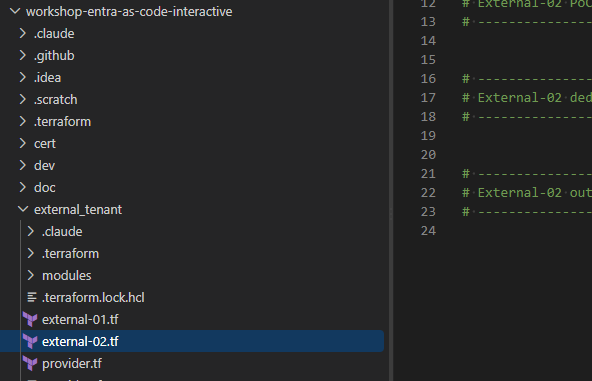

# External-05: Sync the sign-up profile to your API + token enrichment (custom authentication extensions)

External-04 stored first name, last name and the two consent flags in the directory. Most real
systems keep the customer profile in their own API / database (CRM, loyalty, consent registry)
and only use Entra for identity. This stage wires Entra External ID to such a profile API with
two custom authentication extensions (REST calls Entra makes during the flow):

| When                                                  | Event                         | Entra POSTs to                              | Your API answers                                       |
|-------------------------------------------------------|-------------------------------|---------------------------------------------|--------------------------------------------------------|
| The customer presses Continue on the sign-up page | `OnAttributeCollectionSubmit` | `<profile API>/api/OnAttributeCollectionSubmit` | `continueWithDefaultBehavior` (or block / validation error / modify values) |
| A token is about to be issued (every sign-in)         | `OnTokenIssuanceStart`        | `<profile API>/api/OnTokenIssuanceStart`    | `provideClaimsForToken`: claims from the profile       |

Start point: a [Beeceptor](https://beeceptor.com) mock. You don't need to build an API yet. Beeceptor
gives you a public HTTPS endpoint that answers with canned JSON and shows every incoming request
in its console, so you can *see* exactly what Entra sends: e-mail, `givenName`, `surname`,
`extension_…_TermsOfUseAccepted`, `extension_…_PrivacyPolicyAccepted`. Later you point
`profile_api_base_url` at your real API. The paths are the same. Step 9 swaps Beeceptor for a
one-file C# minimal API that does the same thing and keeps the profiles in memory.

> [!IMPORTANT]
> The profile API must be public. Entra External ID calls it from Microsoft's cloud, not from
> your machine, so `profile_api_base_url` must be a public HTTPS URL that Entra can reach.
> `http://localhost:…` never works. Beeceptor is public out of the box. For an API on your laptop
> (step 9), put a tunnel in front of it, for example a Cloudflare tunnel
> (`cloudflared tunnel --url http://localhost:5087`) or a dev tunnel.
>
> Test it end to end with the OIDC debugger. Run
> [`./doc/external-05/New-SpaConfigBase64.ps1`](New-SpaConfigBase64.ps1). It builds the debugger
> link `https://tenant.factorlabs.pl/oidcdebugger?data=<base64>` from the Terraform outputs, with the
> authority, SPA client ID and API scope already filled in. Sign-in returns to
> https://tenant.factorlabs.pl/oidcdebugger/debug, so keep that URI in `poc_spa_redirect_uris`.

> [!IMPORTANT]
> How the sync works and why it takes two events.
> - `OnAttributeCollectionSubmit` fires only at sign-up, before the user object exists. The
>   payload has the e-mail and every collected attribute, but no object ID yet. The API upserts
>   the profile keyed by e-mail.
> - `OnTokenIssuanceStart` fires at every sign-in and carries `authenticationContext.user.id`
>   (the object ID). This is where the API links the profile to the object ID (first sign-in)
>   and returns profile data as token claims.
> - Users who signed up before this stage (for example in External-04) never trigger the submit
>   call. The token call is the place to create a profile for them lazily.
> - The directory still stores the attributes (`writeToDirectory = true`). The API is the system of
>   record for everything else: CRM id, loyalty tier, consent history.

## What will be created

| Object                                  | Display name                                                 | Notes |
|-----------------------------------------|--------------------------------------------------------------|-------|
| App registration (represents your API)  | `TF.Demo.<name>-CustomerHelpdesk-TokenEnrichment.ExtensionAPI`                       | Identifier URI `api://<api host>/<client-id>`, access token v2. Entra gets a token for it (client credentials) before every call. |
| Graph app permission + admin consent    | `CustomAuthenticationExtension.Receive.Payload`              | Granted by Terraform (the portal's Grant permission button). |
| Custom authentication extension         | `TF.<name>.CustomerHelpdesk-TokenEnrichment.OnAttributeCollectionSubmit`             | `onAttributeCollectionSubmitCustomExtension` → `/api/OnAttributeCollectionSubmit`. |
| Custom authentication extension         | `TF.<name>.CustomerHelpdesk-TokenEnrichment.OnTokenIssuanceStart`                    | `onTokenIssuanceStartCustomExtension` → `/api/OnTokenIssuanceStart`, accepts claims `CorrelationId`, `ApiVersion`, `CrmId`, `LoyaltyNumber`, `LoyaltyTier`. |
| Event listener                          | -                                                            | `onTokenIssuanceStartListener` for the Sync SPA and the Sync API. |
| Claims mapping policy                   | `TF.<name>.CustomerHelpdesk-TokenEnrichment.ProfileClaims`                           | `customClaimsProvider.*` → `correlationId`, `apiVersion`, `crmId`, `loyaltyNumber`, `loyaltyTier`. Assigned to the SPA (ID token) and the API (access token). |
| API + SPA                               | `TF.Demo.<name>-CustomerHelpdesk-TokenEnrichment.API.API`, `TF.Demo.<name>-CustomerHelpdesk-TokenEnrichment.Spa.Application` | A fourth `poc_app`. Admin consent is manual (step 6). |
| Sign-up/sign-in user flow               | `TF.Workshop.<name>-CustomerHelpdesk-TokenEnrichment.Flow`                           | Email + password, the External-04 fields, and "When a user submits their information" → the submit extension. |

`<name>` is your `deployment_unique_name`. External-02, 03 and 04 stay untouched. The two custom
attributes are reused from External-04 (they're tenant-wide), so External-04 must be applied.

## How to work with Terraform Workshop

Each Entra External ID workshop step updates its own Terraform file, named after the step:
[`external_tenant/external-05.tf`](../../external_tenant/external-05.tf).
The full solution is in [`doc/result/external_id/external-05.tf`](../result/external_id/external-05.tf).

## Part 1: the profile API registration

Entra never calls an anonymous endpoint. It gets an access token for an app registration that
represents your API and sends it as `Authorization: Bearer …`. The new
[`auth_extension_api`](../../external_tenant/modules/auth_extension_api/main.tf) module creates that
registration, its identifier URI `api://<host>/<client-id>`, and the admin consent for
`CustomAuthenticationExtension.Receive.Payload`.

```hcl
locals {
  # https://my-endpoint.free.beeceptor.com -> my-endpoint.free.beeceptor.com
  profile_api_host = try(regex("^https://([^/]+)", var.profile_api_base_url)[0], "")

  # Same paths as the real profile API: moving from the mock to the real API
  # is a change of profile_api_base_url only.
  profile_api_submit_url = "${trimsuffix(var.profile_api_base_url, "/")}/api/OnAttributeCollectionSubmit"
  profile_api_token_url  = "${trimsuffix(var.profile_api_base_url, "/")}/api/OnTokenIssuanceStart"

  # Claim name in the API response (case-sensitive) => claim name in the token.
  profile_token_claims = {
    CorrelationId = "correlationId"
    ApiVersion    = "apiVersion"
    CrmId         = "crmId"
    LoyaltyNumber = "loyaltyNumber"
    LoyaltyTier   = "loyaltyTier"
  }
}

module "profile_api" {
  source   = "./modules/auth_extension_api"
  name     = "${var.deployment_unique_name}-CustomerHelpdesk-TokenEnrichment"
  api_host = local.profile_api_host
}
```

## Part 2: the submit extension (push the sign-up data)

[`custom_auth_extension`](../../external_tenant/modules/custom_auth_extension/main.tf) creates one
extension (Graph beta `identity/customAuthenticationExtensions`):

```hcl
module "profile_sync_extension" {
  source       = "./modules/custom_auth_extension"
  event        = "attribute_collection_submit"
  display_name = "TF.${var.deployment_unique_name}.CustomerHelpdesk-TokenEnrichment.OnAttributeCollectionSubmit"
  description  = "Push the sign-up profile (name + consents) to the profile API."
  target_url   = local.profile_api_submit_url
  resource_id  = module.profile_api.resource_id

  depends_on = [module.profile_api]
}
```

## Part 3: the CustomerHelpdesk-TokenEnrichment application and the token extension

```hcl
module "sync_app" {
  source            = "./modules/poc_app"
  name              = "${var.deployment_unique_name}-CustomerHelpdesk-TokenEnrichment"
  spa_redirect_uris = var.poc_spa_redirect_uris
}

check "sync_api_open_to_role_less_users" {
  assert {
    condition     = module.sync_app.api_user_assignment_required == false
    error_message = "The CustomerHelpdesk-TokenEnrichment API enterprise application requires user assignment. Role-less customers cannot obtain a token at all."
  }
}

# Token issuance: enrich the SPA's ID token AND the CustomerHelpdesk API's access token.
module "profile_token_extension" {
  source       = "./modules/custom_auth_extension"
  event        = "token_issuance_start"
  display_name = "TF.${var.deployment_unique_name}.CustomerHelpdesk-TokenEnrichment.OnTokenIssuanceStart"
  description  = "Read the customer's profile from the profile API into the token."
  target_url   = local.profile_api_token_url
  resource_id  = module.profile_api.resource_id
  token_claims = keys(local.profile_token_claims)

  listener_app_client_ids = {
    sync_spa = module.sync_app.spa_client_id
    sync_api = module.sync_app.api_client_id
  }

  depends_on = [module.profile_api]
}

module "profile_claims_policy" {
  source       = "./modules/claims_mapping_policy"
  display_name = "TF.${var.deployment_unique_name}.CustomerHelpdesk-TokenEnrichment.ProfileClaims"
  claims       = [for source, jwt in local.profile_token_claims : { source = source, jwt_claim_type = jwt }]

  # ID token (audience = SPA) and access token (audience = API).
  service_principal_object_ids = {
    sync_spa = module.sync_app.spa_service_principal_object_id
    sync_api = module.sync_app.api_service_principal_object_id
  }
}
```

> [!NOTE]
> Three things must line up for a claim to reach the token.
> 1. The API returns it in `provideClaimsForToken` (exact case: `CrmId`, not `crmId`).
> 2. The extension lists it in `claimsForTokenConfiguration` (`token_claims`). Anything else is dropped.
> 3. A claims mapping policy on the token audience's service principal maps
>    `CustomClaimsProvider/<name>` to a JWT claim, and the app accepts mapped claims
>    (`mapped_claims_enabled = true` is already set by `sso_app` and `api_definition`).
>
> The listener and the policy are per application, by token audience: the SPA for the ID token,
> the API for the access token.

## Part 4: the sign-up flow with the submit extension

Same fields as External-04. The only new line is `attribute_collection_submit_extension_id`:

```hcl
module "sync_user_flow" {
  source              = "./modules/user_flow"
  deployment_env_name = var.deployment_env_name
  business_name       = "${var.deployment_unique_name}-CustomerHelpdesk-TokenEnrichment"
  sign_up_allowed     = true

  # The External-04 tenant-level attributes, collected again on THIS flow.
  extra_attributes = [
    {
      attribute    = "givenName"
      display_name = "Given Name"
      description  = "The user's given name (also known as first name)."
      label        = "First name"
      required     = true
    },
    {
      attribute    = "surname"
      display_name = "Surname"
      description  = "The user's surname (also known as family name or last name)."
      label        = "Last name"
      required     = true
    },
    {
      attribute                = module.attr_terms_of_use.id
      display_name             = module.attr_terms_of_use.name
      description              = "The customer accepted the terms of use during sign-up."
      label                    = "I have read and agree to the [terms of use](${var.signup_terms_of_use_url})"
      data_type                = "boolean"
      user_flow_attribute_type = "custom"
      input_type               = "boolean"
      required                 = true
    },
    {
      attribute                = module.attr_privacy_policy.id
      display_name             = module.attr_privacy_policy.name
      description              = "The customer accepted the privacy policy during sign-up."
      label                    = "I have read and agree to the [privacy policy](${var.signup_privacy_policy_url})"
      data_type                = "boolean"
      user_flow_attribute_type = "custom"
      input_type               = "boolean"
      required                 = true
    },
  ]

  # "When a user submits their information" -> POST to the profile API.
  attribute_collection_submit_extension_id = module.profile_sync_extension.id

  app_client_ids = {
    sync_spa = module.sync_app.spa_client_id
  }

  depends_on = [module.sync_app]
}
```

### What changed in the `user_flow` module

One optional input, `attribute_collection_submit_extension_id`, default `null`. When it's set, the
flow's `onAttributeCollectionSubmit` becomes:

```hcl
onAttributeCollectionSubmit = {
  "@odata.type"   = "#microsoft.graph.onAttributeCollectionSubmitCustomExtensionHandler"
  customExtension = { id = var.attribute_collection_submit_extension_id }
}
```

External-01 to 04 don't set it, so their flows are unchanged.

## Part 5: outputs

The full solution has the usual `external_sync_authority`, `external_sync_spa_client_id`,
`external_sync_api_client_id`, `external_sync_api_scope` and `external_sync_user_flow_id`, plus one
object with everything the profile API needs:

```hcl
output "external_sync_profile_api" {
  description = "Everything your profile API (or the Beeceptor mock) must know."
  value = {
    submit_url                  = local.profile_api_submit_url
    token_issuance_url          = local.profile_api_token_url
    expected_audience           = module.profile_api.client_id   # aud of the token Entra sends
    resource_id                 = module.profile_api.resource_id
    submit_extension_id         = module.profile_sync_extension.id
    token_issuance_extension_id = module.profile_token_extension.id
    token_issuance_listener_id  = module.profile_token_extension.listener_id
    claims_mapping_policy_id    = module.profile_claims_policy.id
    claims_returned_by_api      = keys(local.profile_token_claims)
  }
}
```

## Workshop steps

### 1. Prerequisites

- [External-04](../external-04/README.md) applied: `module.attr_terms_of_use` and
  `module.attr_privacy_policy` must exist in your configuration.
- External-00 permissions. This stage uses `CustomAuthenticationExtension.ReadWrite.All`,
  `EventListener.ReadWrite.All`, `Policy.ReadWrite.ApplicationConfiguration` and
  `AppRoleAssignment.ReadWrite.All`, which are all already on the list.

### 2. Create the Beeceptor mock (2 rules)

1. Go to [beeceptor.com](https://beeceptor.com), enter an endpoint name (for example
   `entra-<yourname>`) and create it. Your base URL is `https://entra-<yourname>.free.beeceptor.com`.
2. Mocking Rules → Create New Rule, twice. In both rules: method `POST`, status `200`, response
   header `Content-Type: application/json`.

   Rule 1: request path *exactly matches* `/api/OnAttributeCollectionSubmit`, response body:

   ```json
   {
     "data": {
       "@odata.type": "microsoft.graph.onAttributeCollectionSubmitResponseData",
       "actions": [
         { "@odata.type": "microsoft.graph.attributeCollectionSubmit.continueWithDefaultBehavior" }
       ]
     }
   }
   ```

   Rule 2: request path *exactly matches* `/api/OnTokenIssuanceStart`, response body:

   ```json
   {
     "data": {
       "@odata.type": "microsoft.graph.onTokenIssuanceStartResponseData",
       "actions": [
         {
           "@odata.type": "microsoft.graph.tokenIssuanceStart.provideClaimsForToken",
           "claims": {
             "CorrelationId": "beeceptor-mock",
             "ApiVersion": "mock-1.0",
             "CrmId": "CRM-000123",
             "LoyaltyNumber": "654321",
             "LoyaltyTier": "Gold"
           }
         }
       ]
     }
   }
   ```

> [!WARNING]
> - Don't skip the rules. Without them Beeceptor answers with its default greeting, which
>   isn't a valid Entra response, so the sign-up or sign-in fails.
> - The response must come back within 2 seconds (`timeout_ms`, at most 2000). Beeceptor is fast
>   enough. A slow API breaks the sign-in.
> - Free Beeceptor endpoints are public. Anyone who knows the name can read the request log.
>   Use test identities only (no real e-mail addresses or names) and delete the endpoint after
>   the workshop.

### 3. Configure `external_tenant/terraform.tfvars`

```hcl
profile_api_base_url = "https://entra-<yourname>.free.beeceptor.com"
```

Host only, no path. If you leave it empty, `plan` stops with *"External-05: set
profile_api_base_url in terraform.tfvars"*.

### 4. Add the code and apply

Paste Part 1 to Part 5 into the matching sections of
[`external_tenant/external-05.tf`](../../external_tenant/external-05.tf), then:

```powershell
cd external_tenant
terraform init      # new modules: auth_extension_api, custom_auth_extension, claims_mapping_policy
terraform plan      # expect module.profile_api, 2 x custom_auth_extension (+1 listener),
                    # module.profile_claims_policy (+2 assignments), module.sync_app, module.sync_user_flow
terraform apply
terraform output external_sync_profile_api
```

### 5. Check the result in the portal

Entra admin center (External ID tenant):

1. External Identities → Custom authentication extensions: both extensions. Open each one.
   *API Authentication* shows the `…ExtensionAPI` app with the permission granted, and the
   *Target URL* is your Beeceptor path.
2. External Identities → User flows → `TF.Workshop.<name>-CustomerHelpdesk-TokenEnrichment.Flow` → Custom authentication
   extensions: *When a user submits their information* = the `…OnAttributeCollectionSubmit`
   extension.
3. Enterprise applications → `TF.Demo.<name>-CustomerHelpdesk-TokenEnrichment.Spa.Application` → Single sign-on →
   Attributes & Claims: the custom claims provider and the five `customClaimsProvider.*` claims.

### 6. Grant admin consent for the CustomerHelpdesk-TokenEnrichment SPA (manual, Azure Portal)

App registrations → `TF.Demo.<name>-CustomerHelpdesk-TokenEnrichment.Spa.Application` → API permissions →
Grant admin consent for `<tenant>`. Without it, sign-in ends in `AADSTS65001`.

### 7. Sign up and watch the payloads arrive

Make sure the profile API is reachable from the internet (Beeceptor, or your API behind a
Cloudflare tunnel, see step 9). Entra calls it from the cloud. Then generate the OIDC debugger link
from the Terraform outputs:

```powershell
./doc/external-05/New-SpaConfigBase64.ps1            # -> https://tenant.factorlabs.pl/oidcdebugger?data=<base64>
./doc/external-05/New-SpaConfigBase64.ps1 -ShowJson  # also prints the JSON that was encoded
```

Open the link. The debugger is pre-filled with the authority, the SPA client ID
(`external_sync_spa_client_id`) and the scopes `openid profile offline_access <external_sync_api_scope>`.
After sign-in Entra redirects to https://tenant.factorlabs.pl/oidcdebugger/debug, which shows
the tokens. That URI must be in `poc_spa_redirect_uris`. `-Prefix external_signup` builds the same
link for the External-04 app. Keep the Beeceptor console (or the API console) open in a second tab.

1. Authorize → No account? Create one → new (test) e-mail → code → password.
2. Fill in first name, last name, tick both boxes → Continue.
3. In Beeceptor, a `POST /api/OnAttributeCollectionSubmit` appears. The body contains:

   ```json
   "userSignUpInfo": {
     "attributes": {
       "email":     { "value": "test.user@example.com", "attributeType": "builtIn" },
       "givenName": { "value": "Test", "attributeType": "builtIn" },
       "surname":   { "value": "User", "attributeType": "builtIn" },
       "extension_<appId>_TermsOfUseAccepted":    { "@odata.type": "microsoft.graph.booleanDirectoryAttributeValue", "value": true, "attributeType": "directorySchemaExtension" },
       "extension_<appId>_PrivacyPolicyAccepted": { "@odata.type": "microsoft.graph.booleanDirectoryAttributeValue", "value": true, "attributeType": "directorySchemaExtension" }
     },
     "identities": [ { "signInType": "email", "issuerAssignedId": "test.user@example.com" } ]
   }
   ```

   This is the data your profile API stores. Note there is no object ID yet.
4. Right after, one or two `POST /api/OnTokenIssuanceStart` calls appear, one per token issued
   (the SPA's ID token and the API's access token, since the listener covers both). Each has
   `authenticationContext.user.id` (the new object ID), `user.mail`, `givenName` and `surname`.
   This is where the real API links the profile to the object ID.
   Beeceptor's free tier has a daily request cap, so don't loop sign-ins.
5. Look at the request headers too: `Authorization: Bearer eyJ…`. Decode the token (for example
   with jwt.ms): `aud` = `expected_audience` from the output, and `azp` =
   `99045fe1-7639-4a75-9d4a-577b6ca3810f`.
6. Back in the debugger, decode the ID token: `crmId`, `loyaltyNumber`, `loyaltyTier`,
   `correlationId` and `apiVersion` carry the mock values. The access token for the API
   carries them too.
7. Sign out and sign in again. Only `OnTokenIssuanceStart` is called (no submit). The profile data
   comes from the API on every sign-in.

### 8. Play with the submit response (optional)

Change Beeceptor Rule 1 and sign up with another test address:

- Validation error. The page shows the message next to the field:

  ```json
  { "data": { "@odata.type": "microsoft.graph.onAttributeCollectionSubmitResponseData",
      "actions": [ { "@odata.type": "microsoft.graph.attributeCollectionSubmit.showValidationError",
        "message": "Please fix the errors below.",
        "attributeErrors": { "surname": "The profile API rejected this last name." } } ] } }
  ```
- Block page (`attributeCollectionSubmit.showBlockPage`, with `title` and `message`). Sign-up
  stops and no user is created.
- Modify values (`attributeCollectionSubmit.modifyAttributeValues`, with
  `"attributes": { "givenName": "Changed by API" }`). The user is created with the API's value.

Switch Rule 1 back to `continueWithDefaultBehavior` afterwards.

### 9. Replace Beeceptor with a one-file C# API (optional)

[`profile-api/ProfileApi.cs`](profile-api/ProfileApi.cs) is the Beeceptor mock as one C# file
(.NET 10 file-based app, no `.csproj`): the same two paths and the same answers. It also keeps the
profiles in memory and writes every request, response and stored profile to the console.

| Endpoint | What it does |
|----------|--------------|
| `POST /api/OnAttributeCollectionSubmit` | Upserts a `Profile` record keyed by e-mail: name, both consent flags, consent time, and a generated CRM id and loyalty data. Returns `continueWithDefaultBehavior`. |
| `POST /api/OnTokenIssuanceStart` | Finds the profile by object id, then by e-mail (first sign-in after sign-up), or creates it (users from before this stage). Stores the object id and returns `CorrelationId`, `ApiVersion`, `CrmId`, `LoyaltyNumber`, `LoyaltyTier`. |
| `GET /api/profiles` | Dumps the in-memory store (debug only, unauthenticated). |

1. Run it:

   ```powershell
   cd doc/external-05/profile-api
   dotnet run ProfileApi.cs          # needs the .NET 10 SDK; listens on http://localhost:5087
   ```

   Test it locally first with [`profile-api/ProfileApi.http`](profile-api/ProfileApi.http) (VS Code
   *REST Client* extension, Visual Studio or Rider). Send the requests top to bottom:
   1. sign-up submit,
   2. first token (matched by e-mail),
   3. second token (matched by object ID),
   4. a user from before this stage (profile created on the fly),
   5. a fake bearer token, to see it decoded in the console,
   6. `GET /api/profiles`.

2. Entra must reach it over public HTTPS, so open a tunnel in a second terminal:

   ```powershell
   cloudflared tunnel --url http://localhost:5087
   # or: devtunnel host -p 5087 --allow-anonymous
   ```

3. Put the tunnel's base URL into `terraform.tfvars` and apply. Only the extensions' target URLs and
   the extension API's identifier URI change:

   ```hcl
   profile_api_base_url = "https://<random-words>.trycloudflare.com"
   ```

4. Sign up and sign in again (step 7). The console shows the same payloads as the Beeceptor log,
   plus `STORED profile …` and `LINKED profile …`. Then open `<tunnel>/api/profiles`.

> [!NOTE]
> - A quick `cloudflared` tunnel gets a new host name on every start, so re-apply each time (or use
>   a named tunnel or dev tunnel with a fixed name).
> - Restarting the API empties the store. The token call then recreates profiles with new CRM ids.
> - The API only logs the decoded bearer token. It doesn't validate it (just like Beeceptor), and
>   `/api/profiles` is open. Workshop use only. Step 10 lists what a real API must check.
> - The JSON keeps PascalCase on purpose. ASP.NET's default camelCase would send `crmId`, and
>   Entra drops it because claim names are case-sensitive.

### 10. From the mock to a real profile API

Point `profile_api_base_url` at your API and apply. The identifier URI changes with the host, so the
API registration is updated in place.

> [!CAUTION]
> The real API must validate the bearer token: `iss` exactly as it appears in the token you decoded
> in step 7.5 (a `https://….ciamlogin.com/<tenant-id>/v2.0` issuer), audience = `expected_audience`,
> `azp` = `99045fe1-7639-4a75-9d4a-577b6ca3810f`. Reject anything else.

The real API must also:

- On `/api/OnAttributeCollectionSubmit`: upsert the profile keyed by e-mail (name, consent flags
  plus timestamp, terms version), then return `continueWithDefaultBehavior`.
- On `/api/OnTokenIssuanceStart`: find the profile by `user.id`, falling back to `user.mail`
  for the first sign-in. Store the object ID, then return the claims. Create the profile lazily for
  users who signed up before the submit hook existed.
- Stay under 2 s, and be idempotent: Entra retries once (`maximum_retries = 1`).

A reference implementation of both endpoints (ASP.NET, Cosmos DB profile store) uses the same paths
and claim names.

## Verification

- [ ] Both custom authentication extensions exist, with the API permission granted.
- [ ] `TF.Workshop.<name>-CustomerHelpdesk-TokenEnrichment.Flow` calls the submit extension *When a user submits their information*.
- [ ] Beeceptor shows `OnAttributeCollectionSubmit` with `givenName`, `surname` and both
  `extension_…Accepted = true` for a new sign-up.
- [ ] Beeceptor shows `OnTokenIssuanceStart` on every sign-in, with `authenticationContext.user.id`.
- [ ] The ID token (and the API access token) contain `crmId`, `loyaltyNumber`, `loyaltyTier`,
  `correlationId` and `apiVersion`.
- [ ] External-02, 03 and 04 sign-ins call nothing (their Beeceptor log stays empty).

## Troubleshooting

| Issue | Solution |
|-------|----------|
| `plan`: *"External-05: set profile_api_base_url in terraform.tfvars"* | Step 3. Use `https://<host>` without a path. |
| C# API: claims missing although the console shows the response | Check the claim names are PascalCase in the response (`CrmId`). If you changed the serializer options, Entra drops camelCase names. |
| C# API: nothing in the console | The tunnel URL changed (quick tunnels change on every start). Update `profile_api_base_url` and apply again. |
| `Reference to undeclared module attr_terms_of_use` | External-04's Part 1 is missing from your configuration. |
| 403 creating `msgraph_resource.this` in `custom_auth_extension` | Deployer SP is missing `CustomAuthenticationExtension.ReadWrite.All` (or `EventListener.ReadWrite.All` for the listener). |
| 403 on `azuread_app_role_assignment.receive_payload` | Deployer SP is missing `AppRoleAssignment.ReadWrite.All`. |
| Sign-up fails after Continue with *"Something went wrong"* (error 1003xxx in the sign-in logs) | Entra couldn't use the response. Check that the Beeceptor rule matches the path exactly, the method is POST, the status is 200, `Content-Type: application/json` is set and the JSON is valid. Sign-in logs → Authentication Events shows the extension call and its error. |
| Nothing arrives in Beeceptor | Check the extension's *Target URL* in the portal (no typo, no trailing path). Check that the user flow shows the extension under *Custom authentication extensions*. External-04 users signing in never trigger submit. |
| Error mentioning the token / consent for the extension API | *Grant permission* isn't done. Check that `CustomAuthenticationExtension.Receive.Payload` is granted on `…ExtensionAPI`, and re-apply. |
| Claims don't show in the token | Same case in all three places (see the note in Part 3). Check that the policy is assigned to the token audience's SP, and that the app has `acceptMappedClaims = true` in its manifest. |
| `AADSTS50146` (application-specific signing key / mapped claims) | The app's manifest needs `acceptMappedClaims: true`. `sso_app` and `api_definition` set it. If the app was created by hand, set it in the manifest. |
| Changed `listener_app_client_ids` but the listener still targets the old apps | The listener's app list is fixed at create time: `terraform apply -replace='module.profile_token_extension.msgraph_resource.listener[0]'`. |
| 400 creating the flow, mentioning `onAttributeCollectionSubmit` / `customExtension` | The inline handler reference was rejected. Attach the extension by hand instead: set `attribute_collection_submit_extension_id = null` and apply, then go to User flows → the flow → *Custom authentication extensions* → *When a user submits their information* → pick the `…OnAttributeCollectionSubmit` extension. |
| 400 updating the flow | Recreate it: `terraform apply -replace=module.sync_user_flow.msgraph_resource.this`. |
| `destroy` fails deleting an extension | Something still references it: the user flow, the listener, or something set up by hand. Unlink it in the portal and destroy again. |
| `AADSTS65001` consent required | Do step 6. |

---

## Stage Completion Checklist
- [ ] I have created a Beeceptor endpoint with both mock rules.
- [ ] My profile API is public (Beeceptor or a Cloudflare tunnel). Entra can reach it, `localhost` can't.
- [ ] I have signed in with the link from `./doc/external-05/New-SpaConfigBase64.ps1` and landed on `https://tenant.factorlabs.pl/oidcdebugger/debug`.
- [ ] I have set `profile_api_base_url` and applied External-05.
- [ ] I have manually granted admin consent for the CustomerHelpdesk-TokenEnrichment SPA.
- [ ] I have signed up and seen the sign-up payload (name + consents) in Beeceptor.
- [ ] I have seen the token-issuance call on every sign-in and the profile claims in my tokens.
- [ ] (Optional) I have run `ProfileApi.cs` behind a tunnel and seen the profiles in `/api/profiles`.
- [ ] I know what a real profile API must validate and store.

> Report Issues: Did you encounter a bug or need clarification? [Report the issue here](https://github.com/mjendza/workshop-entra-as-code-interactive/issues).

---
Navigation: [← External-04: Sign-up with extra attributes](../external-04/README.md) | [Next → External-06: Branded sign-in](../external-06/README.md)

## Sources

- [Custom authentication extensions overview](https://learn.microsoft.com/entra/identity-platform/custom-extension-overview)
- [Create a custom authentication extension for attribute collection start and submit events](https://learn.microsoft.com/entra/identity-platform/custom-extension-attribute-collection)
- [OnAttributeCollectionSubmit: request and response schema](https://learn.microsoft.com/entra/identity-platform/custom-extension-onattributecollectionsubmit-retrieve-return-data)
- [Configure a custom claims provider for a token issuance event](https://learn.microsoft.com/entra/identity-platform/custom-extension-tokenissuancestart-configuration)
- [Create authenticationEventListener (Graph beta)](https://learn.microsoft.com/graph/api/identitycontainer-post-authenticationeventlisteners?view=graph-rest-beta)
- [onAttributeCollectionSubmitCustomExtensionHandler (Graph beta)](https://learn.microsoft.com/graph/api/resources/onattributecollectionsubmitcustomextensionhandler?view=graph-rest-beta)
